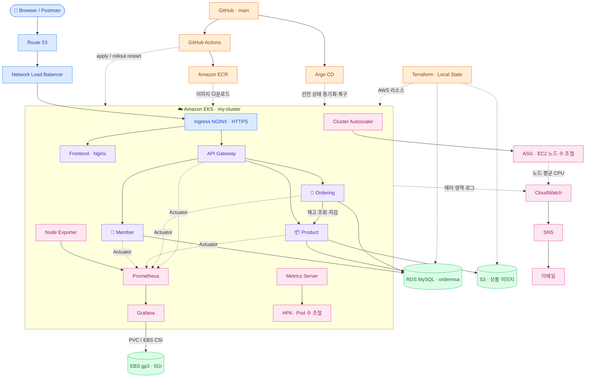
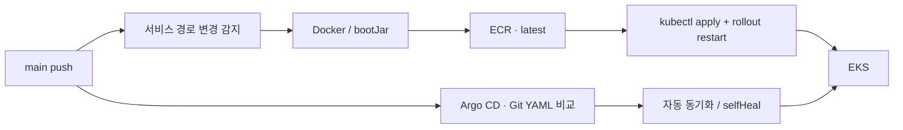
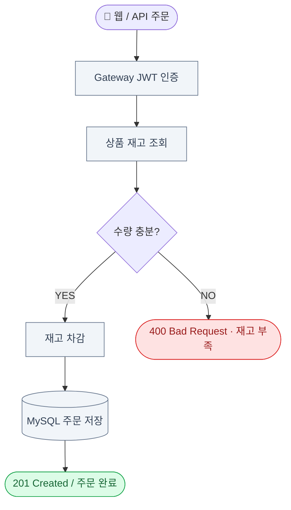
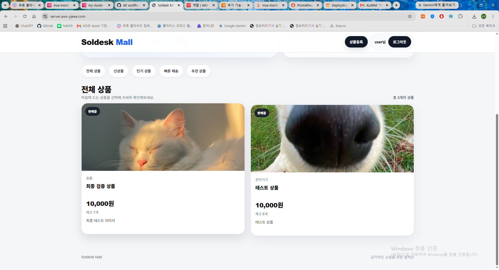
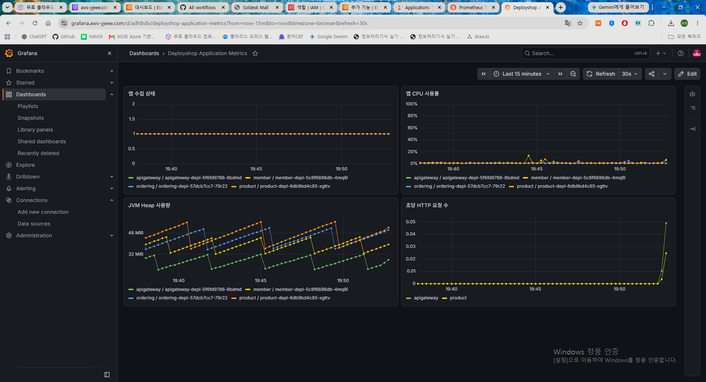
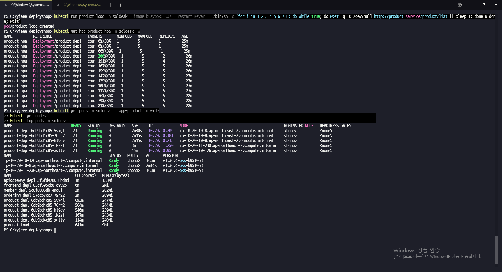

<div align="center">

# 🛒 yjeee-deployshop

### AWS Cloud-Native MSA · DevOps Engineering Portfolio

**Terraform IaC · Amazon EKS · CI/CD · GitOps · Monitoring**

`Infrastructure` → `Deployment` → `Autoscaling` → `Observability` → `Validation`

</div>

---

> 회원·상품·주문 서비스를 AWS EKS에 배포하고, 인프라 구축·자동 배포·자동 확장·모니터링과 실제 주문 검증을 수행한 DevOps 포트폴리오입니다.
>
> **Project Focus** — 수업의 애플리케이션과 실습 흐름을 기반으로 구성했습니다. Java 기능 확장보다 인프라와 배포 설정의 연결, 운영 중 문제 분석 및 검증에 중점을 두었습니다.

검증 기준일은 **2026-10-16 (KST)**입니다. 실습 환경의 접속 주소는 리소스 운영 기간에만 유효합니다.

| 📚 문서 | 내용 |
| :--- | :--- |
| [구축 절차](docs/SETUP.md) | 실행 순서, CLI·콘솔 작업, Terraform 관리 범위 |
| [검증 결과](docs/VALIDATION.md) | 웹·API·DB 대조, 자동 확장·알림 결과와 증거 |
| [트러블슈팅](docs/TROUBLESHOOTING.md) | Grafana OOM·EBS, 인증서 충돌, IAM·ECR 오류 해결 |
| [증거 목록](docs/EVIDENCE.md) | 캡처별 설명, 공개용 가림 처리, 검증 시점 구분 |
| [대시보드 JSON](docs/dashboards/README.md) | 원본 내보내기와 재사용 사본, Import 방법 |
| [교육·복습 노트](docs/learning/STUDY-NOTES.md) | 단계별 명령·의미·정상 결과·오류 해결 및 EBS 상세 설명 |

## 01. System Architecture



브라우저에서 로드한 프런트엔드는 같은 도메인의 API 경로로 요청하며, Ingress가 이를 Gateway에 전달합니다. 워커 노드는 프라이빗 앱 서브넷에 배치합니다. **RDS는 Workbench 실습을 위해 퍼블릭 접근을 유지**하고, 외부 MySQL 접근은 최종적으로 실습 PC 공인 IP `/32`로 제한했습니다. 별도 EKS 보안 그룹 접근 규칙은 유지합니다. 생성된 프라이빗 DB 서브넷은 현재 RDS 배치에 사용하지 않습니다.

## 02. Core Services & Tools

| 서비스 | 역할 | 이미지 저장소 |
| :--- | :--- | :--- |
| 👤 Member | 회원가입·중복 검사·로그인·JWT | `member-service` |
| 📦 Product | 상품 등록·조회·재고 차감·S3 이미지 | `product-service` |
| 🛒 Ordering | 상품 서비스 호출·재고 검사·주문 저장 | `ordering-service` |
| 🌐 API Gateway | 경로 라우팅·JWT 검증·사용자 정보 전달 | `apigateway` |
| 🖥️ Frontend | 쇼핑몰 정적 화면 제공 | `frontend-service` |

| 영역 | 사용 기술 |
| :--- | :--- |
| Cloud / IaC | AWS · Terraform Root + Child Modules · Local State |
| Container / Network | Docker · ECR · EKS · Ingress NGINX · NLB · Route 53 · cert-manager |
| Delivery | GitHub · GitHub Actions · Argo CD |
| Scaling | Metrics Server · CPU 기반 HPA · Cluster Autoscaler |
| Monitoring / Storage | Prometheus · Node Exporter · Actuator / Micrometer · Grafana · EBS CSI / PVC · CloudWatch · SNS |
| 실습 / 검증 | Windows · PowerShell · VS Code · Postman · MySQL Workbench |

## 03. CI/CD & GitOps



- Actions는 변경된 서비스의 이미지를 빌드·업로드하고 직접 배포합니다. ECR은 수업의 `latest` 반복 업로드에 맞춰 `MUTABLE`입니다.
- Argo CD는 Git의 매니페스트와 실제 리소스의 차이를 동기화합니다. `msa-root`가 하위 Application 선언을 관리합니다.
- 백엔드 Pod 수는 HPA가 관리하고, Argo CD는 `/spec/replicas`를 제외합니다. 프런트엔드는 Git의 `replicas: 1` 자동 복구를 검증했습니다.
- **현재는 Actions 직접 배포와 Argo CD 동기화를 함께 사용**합니다. 이미지 태그를 Git에 갱신해 Argo CD만 배포하는 구조로 표기하지 않습니다.

## 04. Order Processing & End-to-End Validation



**🌐 쇼핑몰 → 📮 Postman → 🗄️ Workbench**에서 동일 상품 ID `2`를 대조했습니다.

| 검증 | API / 웹 결과 | DB 결과 |
| :--- | :--- | :--- |
| 초기 상태 | 상품·S3 이미지 표시 | 재고 `10`, 해당 상품 주문 `0건` |
| 웹에서 1개 구매 | 주문 완료 | 재고 `9`, 주문 ID `3`, 수량 `1` |
| Postman에서 2개 구매 | `201 Created`, 주문 ID `4` | 재고 `7`, 주문 2건·수량 `1/2` |
| 남은 재고 7개에서 8개 구매 | `400`, `재고 부족` | 재고 `7`·주문 `2건` 유지 |

> 순차 주문의 기능 결과를 검증했습니다. 동시 주문 락·원자적 재고 차감·분산 트랜잭션 보장 및 결제 연동은 완료 기능에 포함하지 않습니다.

## 05. Scaling & Observability

| 검증 항목 | 확인 결과 |
| :--- | :--- |
| HPA | 상품 조회 부하로 상품 Pod `1 → 5`, 부하 종료 후 `5 → 1` |
| Cluster Autoscaler | 같은 부하 실습에서 노드 `2 → 3`, 종료 후 최소 `2` 복귀를 확인 |
| Prometheus | `node-exporter`, `spring-apps` Targets `UP` 및 `up=1` |
| Grafana | 노드 CPU·메모리·디스크·네트워크, 앱 수집 상태·프로세스 CPU·Heap·HTTP 요청 시각화 |
| CloudWatch Logs | EKS `api`, `audit`, `authenticator` 로그 스트림 확인 |
| CloudWatch / SNS | ASG 평균 CPU 경보 설정, 수동 상태 전환으로 ALARM 알림·OK 복귀 확인 |

CloudWatch 경보는 **80% 이상인 5분 평균 2회 연속** 조건입니다. 알림 경로는 `set-alarm-state`로 검증했으며, 실제 CPU 80% 초과를 10분 유지한 테스트로 기록하지 않습니다. 앱 컨테이너 로그의 CloudWatch 전송이나 주문 완료 SNS 발송은 이번 구현 범위에 포함하지 않습니다.

## 06. Troubleshooting Highlights

| 문제 | 확인한 원인 / 조치 | 검증 |
| :--- | :--- | :--- |
| Grafana 로그인·대시보드 초기화 | `OOMKilled / 137`, 한도 `500Mi`; `1Gi`로 조정하고 `/var/lib/grafana`에 EBS PVC 연결 | Pod 재생성 후 변경 비밀번호·데이터 소스·대시보드 보존 |
| 모니터링 Certificate 반복 OutOfSync | Ingress 자동 생성과 별도 Certificate 선언이 같은 설정을 관리 | Ingress의 issuer annotation 제거 후 동기화·HTTPS 확인 |
| Autoscaler 노드그룹 조회 실패 | `eks:DescribeNodegroup` 누락 | 해당 노드그룹 조회 권한 추가 후 확장 실습 성공 |
| Windows ECR 로그인 400 | PowerShell 파이프 전달 문제로 추정 | 동일 인증을 `cmd /c` 파이프로 실행해 성공 |

상세 원인·명령·권한·검증 근거는 [트러블슈팅 문서](docs/TROUBLESHOOTING.md)에 정리했습니다.

## 07. Repository Structure

```text
yjeee-deployshop/
├── .github/workflows/            # 이미지 빌드 및 직접 배포
├── apps/                        # 서비스 소스·Dockerfile
│   ├── apigateway/
│   ├── frontend/
│   ├── member/
│   ├── ordering/
│   └── product/
├── deploy/
│   ├── argocd/                  # root / 하위 Application 선언
│   └── k8s/
│       ├── apps/                # 서비스별 Deployment·Service
│       └── platform/            # Ingress·인증서·HPA·CA·모니터링
├── terraform/                   # 여기서만 init / plan / apply
│   └── modules/                 # network·iam·eks·rds·ecr·s3
└── docs/
    ├── SETUP.md
    ├── VALIDATION.md
    ├── TROUBLESHOOTING.md
    ├── EVIDENCE.md
    ├── images/                  # 공개용 캡처 사본
    ├── dashboards/              # Grafana JSON
    └── learning/                # 교육·복습 노트 MD / TXT
```

Terraform은 AWS 기본 리소스와 CloudWatch/SNS를 관리합니다. **Route 53 레코드·CA용 OIDC/IAM·EBS CSI용 IAM 및 애드온은 콘솔에서 구성**했습니다. NLB는 Controller의 Service, Grafana EBS는 PVC에 의해 생성됩니다. 모든 리소스를 Terraform으로 관리한다고 표현하지 않습니다.

## 08. Evidence Preview







[전체 검증·캡처 목록 보기](docs/EVIDENCE.md)

## 09. Scope & Operations Notes

- 학습용 단일 환경입니다. RDS는 Single-AZ이며 공개 접근을 유지하고 최종 Workbench 허용 범위는 PC 공인 IP `/32`입니다.
- AWS 키·DB 비밀번호·Terraform State/tfvars는 Git에 포함하지 않습니다. 공개 자료 중 로그인·SNS 메일 2개는 AI 편집한 가림 설명용 사본입니다. 원본 검증 캡처와 구분한 내역은 증거 목록에 기록했습니다.
- Grafana는 EBS gp3 `5Gi`·RWO PVC·`Recreate`를 사용합니다. Pod 교체 시 일시 중단이 있고, EBS는 같은 AZ의 노드에서 다시 연결됩니다. AZ 장애 대응·백업 복구 검증까지 완료한 구성은 아닙니다.
- Grafana는 영구 저장하지만 현재 Prometheus에는 영구 데이터 볼륨이 없어 Pod 교체 시 이전 시계열이 유실될 수 있습니다.
- 수업의 AWS 키 인증·`latest` 이미지·CA FullAccess 정책을 유지했고 부족한 조회 권한을 보완했습니다. 운영 환경 최소 권한·불변 태그 전환은 별도 개선 과제입니다.
- retained EBS/PVC, RDS 삭제 보호·스냅샷, S3 객체/버전, 로그 그룹 보호 등은 실습 종료 시 별도 확인해야 합니다. 자동 삭제가 완료된 것으로 기록하지 않습니다.

---

<div align="center">

**실제 실행 결과와 오류 해결 과정을 함께 기록한 DevOps 포트폴리오**

<sub>yjeee-deployshop · 검증 기준 2026-10-16 · 수업 실습 기반</sub>

</div>
