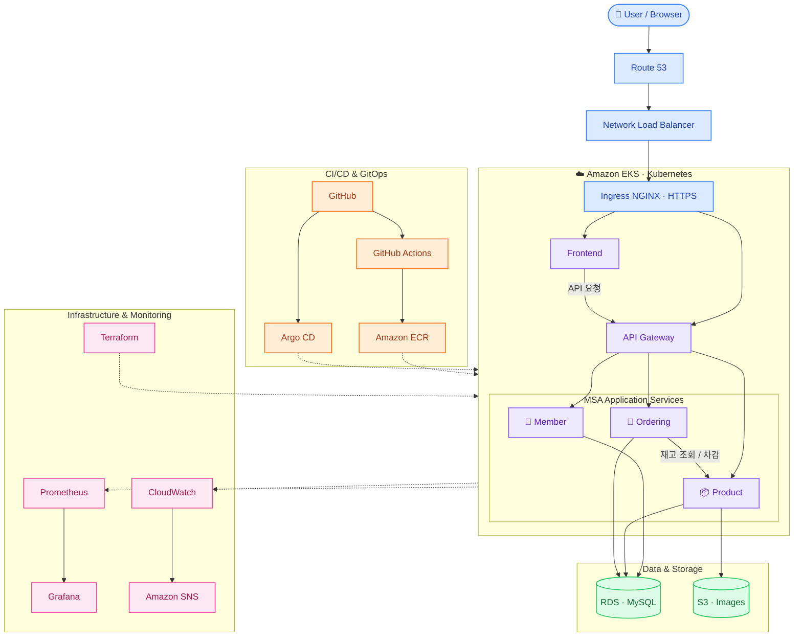
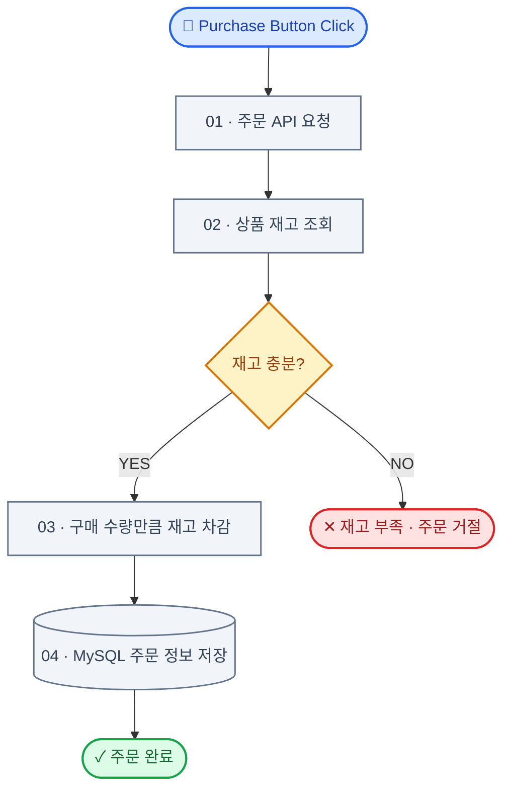

[README.md](https://github.com/user-attachments/files/33522600/README.md)

# 🛒 yjeee-deployshop

### AWS Cloud-Native MSA · DevOps Engineering Portfolio

**Terraform IaC · Amazon EKS · CI/CD · GitOps · Monitoring**

---

> 회원·상품·주문 기능을 갖춘 온라인 쇼핑몰을 AWS EKS에 배포하고, **인프라 구축부터 배포 자동화, 모니터링, 서비스 검증까지** 구현하는 DevOps 포트폴리오 프로젝트입니다.
>
> **Project Focus** — 애플리케이션 개발 자체보다 **클라우드 인프라 설계, Kubernetes 운영, CI/CD 자동화 및 서비스 안정성 검증**에 중점을 둡니다.

## 01. System Architecture

사용자 요청 흐름을 중심으로 **MSA 애플리케이션, 데이터 저장소, CI/CD, 인프라 자동화 및 모니터링**을 구분했습니다.

### Architecture 구성 요소

| 영역 | 핵심 기술 | 역할 |
| :--- | :--- | :--- |
| 🌐 **Traffic & Networking** | Route 53 → NLB → Ingress NGINX | 사용자 요청 라우팅 및 HTTPS 통신 |
| ☸️ **Application** | Amazon EKS · MSA | 마이크로서비스 배포 및 내부 API 통신 |
| 🗄️ **Data & Storage** | Amazon RDS · Amazon S3 | 주문·상품 데이터 및 이미지 저장 |
| 🚀 **CI/CD & GitOps** | GitHub Actions · ECR · Argo CD | 컨테이너 이미지 빌드 및 배포 자동화 |

> **다이어그램 안내:** 실선은 사용자 요청·데이터 처리 흐름, 점선은 배포·운영·모니터링 관계입니다. CloudWatch 및 SNS는 최종 모니터링 구성·검증 대상으로 표시했습니다.

---

## 02. Core Services

| 서비스 | 핵심 기능 |
| :--- | :--- |
| 👤 **Member Service** | 회원가입, 중복 회원 검사, 로그인, JWT 인증 및 토큰 재발급 |
| 📦 **Product Service** | 상품 등록·목록·상세 조회, S3 이미지 업로드 및 재고 관리 |
| 🛒 **Ordering Service** | 구매 요청, 재고 확인·차감 및 주문 데이터 저장 |
| 🖥️ **Frontend / API Gateway** | 쇼핑몰 UI 제공 및 마이크로서비스 API 요청 전달 |

---

## 03. Order Processing Flow

구매 버튼 클릭부터 **재고 확인 → 재고 차감 → 주문 저장**까지의 처리 과정입니다.

**주문 시스템 핵심:** 주문 서비스가 상품 서비스와 **내부 API로 통신**하여 재고를 확인하고, 구매 수량만큼 차감한 뒤 주문 정보를 MySQL에 저장합니다. 재고가 부족하면 주문을 거절합니다.

> **구현 범위:** 재고 확인·차감 로직은 있지만, 동시 주문에 대한 별도 락·원자적 재고 차감 및 분산 트랜잭션 보장을 구현 완료 기능으로 표기하지 않습니다.

---

## 04. Tech Stack & Tools

| 영역 | 기술 및 도구 | 활용 목적 |
| :--- | :--- | :--- |
| ☁️ **Cloud & IaC** | **AWS**, **Terraform**, Amazon EKS, RDS, S3 | AWS 인프라 코드화 및 자동 구축 |
| 🐳 **Containers** | **Docker**, **Kubernetes**, Amazon ECR, Ingress NGINX | 이미지 빌드, 배포 및 서비스 라우팅 |
| 🚀 **CI/CD & GitOps** | **GitHub**, GitHub Actions, Argo CD | 형상 관리, 빌드 및 배포 자동화 |
| 📊 **Monitoring** | Prometheus, Grafana, **CloudWatch**, **Amazon SNS** | 메트릭 시각화, AWS 경보 및 알림 구성 |
| 🛠️ **Development & Testing** | **VS Code**, **Postman**, **MySQL Workbench** | 인프라 코드 작성, API 테스트 및 DB 검증 |

**Networking & Security:** Route 53 · NLB · cert-manager · HTTPS/TLS

---

## 05. End-to-End Validation

### 🌐 Online Shopping Website → 📮 Postman → 🗄️ MySQL Workbench

웹 화면에서 발생한 주문이 **API 처리와 실제 데이터베이스 변경**으로 이어지는지 단계별로 검증합니다.

| 단계 | 검증 도구 | 검증 항목 |
| :---: | :--- | :--- |
| **01** | 🌐 **온라인 쇼핑몰** | 회원 로그인, 상품 목록·상세 조회, 구매 버튼 동작 및 주문 결과 |
| **02** | 📮 **Postman** | 회원 인증·상품 조회·주문 생성 API, 성공 및 재고 부족 응답 |
| **03** | 🗄️ **MySQL Workbench** | 주문 레코드 생성 여부, 상품 재고 차감 전후 데이터 비교 |

**검증 포인트:** 사용자 화면의 구매 요청부터 HTTP API 응답, MySQL의 주문 데이터 및 재고 수량 변화까지 연결해 확인합니다.

---

## 06. Monitoring & Operations

| 도구 | 목적 |
| :--- | :--- |
| **Prometheus** | Kubernetes 및 서비스 메트릭 수집 |
| **Grafana** | Pod·클러스터 상태 대시보드 시각화 |
| **Amazon CloudWatch** | AWS 리소스 지표 관측 및 경보 구성 |
| **Amazon SNS** | CloudWatch 경보 발생 시 알림 전달 |

> **진행 상태:** CloudWatch 경보 및 SNS 알림은 최종 모니터링·검증 단계의 구성 대상이며, 실제 알림 전달 테스트 완료 여부는 별도 확인이 필요합니다.

---

**PROJECT WORKFLOW**

`Terraform IaC` → `EKS Deployment` → `CI/CD & GitOps` → `Monitoring` → `End-to-End Validation`

yjeee-deployshop · DevOps Engineering Portfolio

