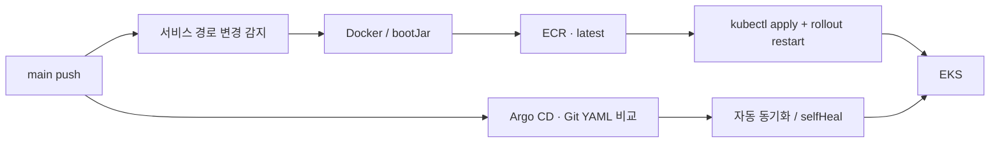
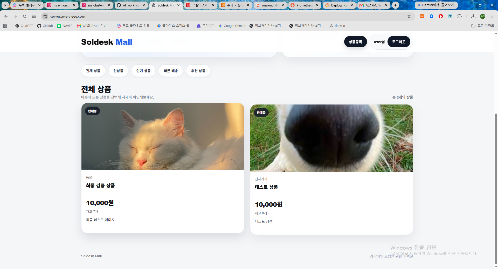
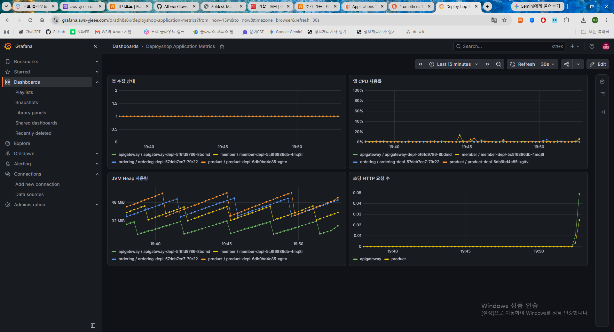
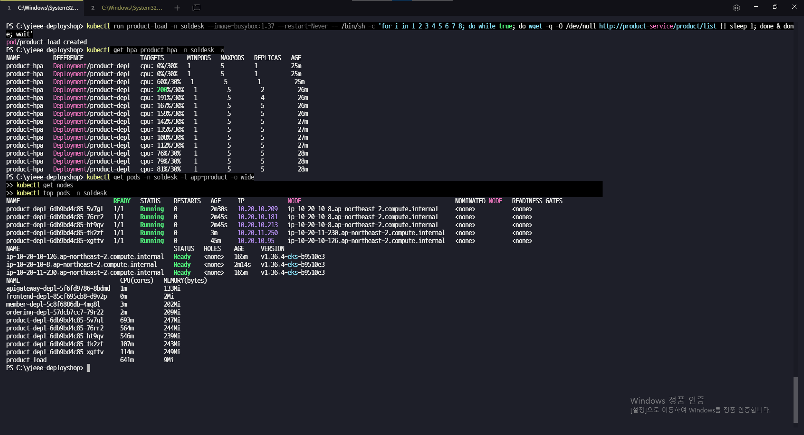

<div align="center">

# 🛒 yjeee-deployshop

### AWS Cloud-Native MSA · DevOps Engineering Portfolio

**Terraform IaC · Amazon EKS · CI/CD · GitOps · Monitoring**

`Infrastructure` → `Deployment` → `Autoscaling` → `Observability` → `Validation`

</div>

---

> 회원·상품·주문 서비스의 AWS EKS 배포와 인프라 구축·자동 배포·자동 확장·모니터링·주문 검증을 연결한 DevOps 포트폴리오.
>
> **Project Focus** — 수업 애플리케이션 기반의 인프라 구성·배포 연결·운영 문제 해결·실행 검증.

| 📚 문서 | 내용 |
| :--- | :--- |
| [구축 절차](docs/SETUP.md) | 실행 순서, CLI·콘솔 작업, Terraform 관리 범위 |
| [실행 및 검증 결과](docs/VALIDATION.md) | 실행 설명·강조 캡처·확인 포인트·결과를 한 문서에서 확인 |
| [문제 분석 및 해결](docs/TROUBLESHOOTING.md) | Grafana OOM·EBS, HPA·Argo CD 충돌, 인증서 충돌 해결 |
| [핵심 개념 복습](docs/learning/CORE-REVIEW.md) | 개인·팀 프로젝트의 기술 선택 이유와 동작 원리 |
| [교육·복습 노트](docs/learning/STUDY-NOTES.md) | 단계별 명령·의미·정상 결과·오류 해결 및 EBS 상세 설명 |

[전체 문서 보기](docs/README.md)

## 01. System Architecture


[상세 아키텍처 보기](docs/ARCHITECTURE.md)

Route 53으로 DNS 조회 → Frontend 로드 → 같은 도메인의 API 경로로 요청. Terraform·CLI·콘솔별 관리 범위는 [구축 절차](docs/SETUP.md)에서 확인.

## 직접 수행한 범위와 기술 선택

직접 수행: **인프라 구성·배포 연결·운영 문제 해결·실행 검증**. 회원·상품·주문 애플리케이션은 수업 제공 코드 기반.

| 선택 | 프로젝트에서의 목적 |
|---|---|
| Terraform / EKS | AWS 기본 자원 모듈화와 서비스별 컨테이너 배포·확장 실습 |
| Actions / Argo CD | 변경 서비스 이미지 배포와 Git 선언 상태 복구. 현재 직접 배포와 GitOps 혼용 |
| HPA / Cluster Autoscaler | Pod와 노드 용량을 각각 제어 |
| Prometheus / Grafana / EBS | 앱·노드 메트릭 관찰과 Grafana 설정 보존 |

대표 결과: 상품 Pod **1 → 5 → 1** 확장·축소, **HPA·Argo CD 제어 충돌 해소**, **Grafana OOM·설정 소실 해결**. [실행 및 검증 결과](docs/VALIDATION.md).

## 02. Core Services & Tools

| 서비스 | 역할 | 이미지 저장소 |
| :--- | :--- | :--- |
| 👤 Member | 회원가입·중복 검사·로그인·JWT | `member-service` |
| 📦 Product | 상품 등록·조회·재고 차감·S3 이미지 | `product-service` |
| 🛒 Ordering | 상품 서비스 호출·재고 검사·주문 저장 | `ordering-service` |
| 🌐 API Gateway | 경로 라우팅·JWT 검증·사용자 정보 전달 | `apigateway` |
| 🖥️ Frontend | 쇼핑몰 정적 화면 제공 | `frontend-service` |

| 영역 | 사용 기술 |
| :--- | :--- |
| Cloud / IaC | AWS · Terraform Root + Child Modules · Local State |
| Container / Network | Docker · ECR · EKS · Ingress NGINX · NLB · Route 53 · cert-manager |
| Delivery | GitHub · GitHub Actions · Argo CD |
| Scaling | Metrics Server · CPU 기반 HPA · Cluster Autoscaler |
| Monitoring / Storage | Prometheus · Node Exporter · Actuator / Micrometer · Grafana · EBS CSI / PVC · CloudWatch · SNS |
| 실습 / 검증 | Windows · PowerShell · VS Code · Postman · MySQL Workbench |

## 03. CI/CD & GitOps



- **Actions:** 변경 서비스 이미지 빌드·ECR 업로드 → kubectl 직접 배포. `latest` 태그·`MUTABLE` 저장소 사용.
- **Argo CD:** `msa-root`로 하위 Application 관리, Git 매니페스트와 실제 상태 동기화.
- **replicas 제어:** Backend는 HPA 관리·Argo CD 비교 제외, Frontend는 Git의 `replicas: 1`로 자동 복구 확인.
- **현재 배포 방식:** Actions 직접 배포 + Argo CD 선언 동기화. 이미지 태그의 Git 자동 갱신은 미구현.

## 04. Order Processing & End-to-End Validation

웹·API·DB 대조: 순차 주문 후 재고 `10 → 9 → 7`·주문 저장 확인. 재고 7개에서 8개 주문 시 `400` 반환·기존 데이터 유지.

[실행 및 검증 결과](docs/VALIDATION.md) · 미검증: 동시 주문 정합성·분산 트랜잭션·결제.

## 05. Scaling & Observability

| 검증 항목 | 확인 결과 |
| :--- | :--- |
| HPA | 상품 조회 부하로 상품 Pod `1 → 5`, 부하 종료 후 `5 → 1` |
| Cluster Autoscaler | 부하 실습에서 노드 `2 → 3` 확장 확인 |
| Prometheus | `node-exporter`, `spring-apps` Targets `UP` 및 `up=1` |
| Grafana | 노드 CPU·메모리·디스크·네트워크, 앱 수집 상태·프로세스 CPU·Heap·HTTP 요청 시각화 |
| CloudWatch Logs | EKS `api`, `audit`, `authenticator` 로그 스트림 확인 |
| CloudWatch / SNS | ASG 평균 CPU 경보 설정, 수동 상태 전환으로 ALARM 알림·OK 복귀 확인 |

CloudWatch 경보: **5분 평균 CPU 80% 이상, 2회 연속**. 수동 ALARM 전환으로 SNS 전달 경로 확인. 실제 CPU 임계값 초과는 미검증, 앱 로그 전송·주문 SNS 연동은 미구현.

## 06. 문제 분석 및 해결

| 문제 | 확인한 원인 / 조치 | 검증 |
| :--- | :--- | :--- |
| Grafana 로그인·대시보드 초기화 | `OOMKilled / 137`, 한도 `500Mi`; `1Gi`로 조정하고 `/var/lib/grafana`에 EBS PVC 연결 | Pod 재생성 후 설정 유지 확인 |
| HPA·Argo CD의 Pod 수 제어 충돌 | HPA의 확장값을 Argo CD가 Git의 고정 replicas로 되돌리는 제어 충돌 | `/spec/replicas`를 `ignoreDifferences`로 제외하고 `RespectIgnoreDifferences=true` 적용 |
| 모니터링 Certificate 반복 OutOfSync | Ingress 자동 생성과 별도 Certificate 선언이 같은 설정을 관리 | Ingress의 issuer annotation 제거 후 동기화·HTTPS 확인 |

원인·조치·확인 결과: [문제 분석 및 해결](docs/TROUBLESHOOTING.md).

## 07. Repository Structure

```text
yjeee-deployshop/
├── .github/workflows/            # 이미지 빌드 및 직접 배포
├── apps/                        # 서비스 소스·Dockerfile
│   ├── apigateway/
│   ├── frontend/
│   ├── member/
│   ├── ordering/
│   └── product/
├── deploy/
│   ├── argocd/                  # root / 하위 Application 선언
│   └── k8s/
│       ├── apps/                # 서비스별 Deployment·Service
│       └── platform/            # Ingress·인증서·HPA·CA·모니터링
├── terraform/                   # 여기서만 init / plan / apply
│   └── modules/                 # network·iam·eks·rds·ecr·s3
└── docs/
    ├── SETUP.md
    ├── VALIDATION.md
    ├── TROUBLESHOOTING.md
    ├── images/                  # 공개용 캡처 사본
    └── learning/                # 교육·복습 노트 MD / TXT
```

Terraform: AWS 기본 자원·CloudWatch/SNS 관리. **Route 53·CA용 OIDC/IAM·EBS CSI 역할 및 애드온은 콘솔 설정**. NLB는 LoadBalancer Service, Grafana EBS는 PVC로 생성.

## 08. 실행 및 검증 결과

<details>
<summary>주문·모니터링·확장 증거 캡처 보기</summary>







</details>

[실행 및 검증 결과](docs/VALIDATION.md)

## 09. Scope & Operations Notes

- **네트워크·DB:** 학습용 단일 환경·Single-AZ RDS·공개 접근. 외부 Workbench 허용 범위는 PC 공인 IP `/32`.
- **인증값:** AWS 키·DB 비밀번호·Terraform State/tfvars는 Git 추적 제외.
- **Grafana:** EBS gp3 `5Gi`·RWO PVC·`Recreate`. 같은 AZ에서 볼륨 재연결, 재배포 중 일시 중단 가능. AZ 장애 복구는 미검증.
- **Prometheus:** 영구 볼륨 미적용. Pod 교체 시 이전 시계열 유실 가능.
- **개선 과제:** AWS 키 인증·`latest` 태그·CA FullAccess 정책을 최소 권한·불변 태그 방식으로 개선.
- **종료 시 확인:** Retain EBS/PVC·RDS 삭제 보호 및 스냅샷·S3 객체와 버전·로그 그룹 보호.

---

<div align="center">

**실제 실행 결과와 오류 해결 과정을 함께 기록한 DevOps 포트폴리오**

<sub>yjeee-deployshop · AWS MSA DevOps Portfolio</sub>

</div>
