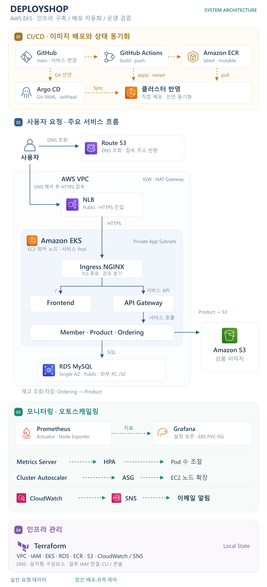
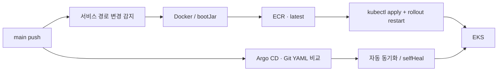

# 🛒 yjeee-deployshop

### AWS EKS 인프라 구축과 배포·운영 검증

**Terraform · Amazon EKS · GitHub Actions · Argo CD · Monitoring**

---

회원·상품·주문으로 구성된 MSA 쇼핑몰의 **AWS 인프라를 구축하고, 컨테이너 배포·자동화·운영 검증까지 연결한 개인 프로젝트입니다.**

Terraform으로 기반 자원을 구성하고 EKS에 서비스를 배포했습니다. 이후 코드 변경 반영, 부하에 따른 확장, 메트릭·로그·알림 수집과 주문 처리를 검증했습니다.

### 직접 수행한 범위

| 영역 | 수행 내용 |
| :--- | :--- |
| **인프라 구축** | Terraform 모듈 구성, VPC·IAM·EKS·RDS·ECR·S3 연결 |
| **서비스 배포** | 서비스별 Docker 이미지·Kubernetes 배포 구성, Ingress·DNS·HTTPS 연결 |
| **배포 자동화** | GitHub Actions 빌드·ECR push·직접 배포, Argo CD 선언 동기화·self-heal 구성 |
| **운영 구성·검증** | HPA·CA, 메트릭·로그·알림 구성, 웹·API·DB 대조와 운영 문제 해결 |

[구축 절차](docs/SETUP.md) · [실행 및 검증 결과](docs/VALIDATION.md)

## 01. System Architecture

[상세 아키텍처 보기](docs/ARCHITECTURE.md)

- **요청:** Route 53으로 DNS를 조회한 뒤 NLB·Ingress NGINX를 거쳐 Frontend 또는 API Gateway로 접근합니다. Gateway는 Member·Product·Ordering으로 요청을 전달합니다.
- **데이터:** 회원·상품·주문은 RDS MySQL에, 상품 이미지는 S3에 저장합니다.
- **관리:** Terraform으로 AWS 기본 자원을 구성했습니다. CLI·콘솔 연결 범위는 [구축 절차](docs/SETUP.md)에서 확인할 수 있습니다.

## 02. 기술 선택과 구현

| 선택 | 선택 이유와 적용 방식 |
| :--- | :--- |
| **Terraform / EKS** | AWS 자원을 모듈로 관리하고, 서비스별 컨테이너 배포·확장 구성 |
| **Actions / Argo CD** | 변경 서비스의 이미지 빌드·직접 배포와 Git 선언 상태의 동기화·복구를 연결 |
| **HPA / Cluster Autoscaler** | 애플리케이션 Pod 수와 이를 수용할 노드 용량을 각각 제어 |
| **Prometheus / Grafana / EBS** | 노드·앱 지표 수집과 시각화, Grafana 설정의 영구 저장 구성 |
| **CloudWatch / SNS** | EKS 제어 영역 로그 수집, 노드 그룹 CPU 경보·이메일 전달 경로 구성 |

### 배포 흐름

Actions는 이미지를 빌드해 직접 배포하고, Argo CD는 Git 선언과 실제 상태를 동기화합니다. Backend replicas는 HPA가, Frontend의 고정 replicas는 Git이 관리합니다.

## 03. 대표 문제 해결

| 문제 | 원인과 조치 | 확인 결과 |
| :--- | :--- | :--- |
| **HPA 확장 후 Pod 수 복귀** | Argo CD가 고정 replicas 재적용 → `/spec/replicas` 제외·`RespectIgnoreDifferences=true` 적용 | HPA의 Pod 수 제어와 Argo CD 동기화 역할 분리 |
| **Grafana 종료·설정 소실** | `OOMKilled / 137`·영구 저장소 미연결 → limit `500Mi → 1Gi`·EBS gp3 `5Gi` PVC 연결 | Pod 재시작 후 설정 유지 |
| **Certificate 반복 OutOfSync** | Ingress 자동 생성과 명시적 Certificate의 중복 관리 → issuer annotation 제거 | 동기화·HTTPS 정상 확인 |

문제별 증상·원인·조치·확인 결과는 [문제 분석 및 해결](docs/TROUBLESHOOTING.md)에 정리했습니다.

## 04. 기능·운영 검증

| 검증 대상 | 확인 결과 |
| :--- | :--- |
| **웹·API·DB 주문 대조** | 동일 상품의 순차 구매 후 재고 `10 → 9 → 7`·주문 저장, 초과 주문 `400`·기존 데이터 유지 |
| **메트릭 수집·시각화** | 노드·앱 Targets `UP`·`up=1`, Grafana 패널 표시 |
| **로그·경보 전달** | EKS 제어 영역 로그 확인, 수동 ALARM 전환 → SNS 이메일 전달·OK 복귀 |

실행 내용과 강조 캡처, 확인 포인트는 [실행 및 검증 결과](docs/VALIDATION.md)에서 함께 확인할 수 있습니다.

## 05. 상세 문서

| 문서 | 확인할 내용 |
| :--- | :--- |
| [구축 및 재현 절차](docs/SETUP.md) | 실행 순서·Terraform 및 CLI·콘솔 관리 범위 |
| [실행 및 검증 결과](docs/VALIDATION.md) | 실행 과정과 검증 캡처 |
| [문제 분석 및 해결](docs/TROUBLESHOOTING.md) | 문제별 원인·조치·결과 |

[프로젝트 문서 목록](docs/README.md)

## 06. 구성·검증 범위

- **실습 구성:** Local State·`latest` 이미지·AWS 키 인증을 사용했습니다. Route 53·일부 IAM·EBS CSI 연결은 콘솔에서 구성했습니다.
- **데이터·접근:** Single-AZ Public RDS를 사용하며 외부 PC 접근은 `/32`로 제한했습니다. Grafana는 EBS에 저장하고, Prometheus에는 영구 볼륨을 적용하지 않았습니다.
- **검증 범위:** 동시 주문 정합성·결제·실제 CPU 임계값 초과·AZ 장애 복구는 검증하지 않았습니다. 이미지 태그의 Git 자동 갱신과 주문 SNS 연동은 구현하지 않았습니다.

---

**인프라 구성부터 배포·확장·문제 해결·실행 검증까지 연결한 개인 프로젝트**

