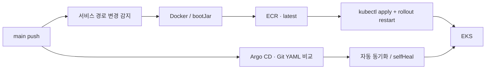

# 🛒 yjeee-deployshop

### AWS EKS 인프라 구축과 배포·운영 검증

**Terraform · Amazon EKS · GitHub Actions · Argo CD · Monitoring**

---

회원·상품·주문으로 구성된 쇼핑몰을 **AWS EKS에 배포하고, 자동 배포·확장·관측을 연결해 동작을 검증한 개인 프로젝트**.

애플리케이션은 수업 제공 코드 기반. 직접 수행한 범위는 **AWS 인프라 구성, 컨테이너 배포 연결, 운영 문제 해결, 웹·API·DB 검증**.

| 핵심 경험 | 직접 수행하고 확인한 내용 |
| :--- | :--- |
| **부하에 따른 자동 확장** | 상품 조회 부하 생성·제거 → 상품 Pod **1 → 5 → 1**, 노드 **2 → 3** 확장 확인 |
| **배포 제어 충돌 해결** | HPA와 Argo CD의 replicas 관리 분리 → 확장값이 Git 고정값으로 되돌아가는 문제 해소 |
| **Grafana 설정 보존** | OOM 원인 분석·메모리 조정·EBS PVC 연결 → 재시작 후 계정·데이터 소스·대시보드 유지 확인 |

[실행 및 검증 결과](docs/VALIDATION.md) · [문제 분석 및 해결](docs/TROUBLESHOOTING.md)

## 01. System Architecture

[상세 아키텍처 보기](docs/ARCHITECTURE.md)

- **요청:** Route 53으로 DNS 조회 → NLB → Ingress NGINX → Frontend / API Gateway → Member·Product·Ordering.
- **데이터:** RDS MySQL에 회원·상품·주문 저장, S3에 상품 이미지 저장.
- **관리:** Terraform으로 AWS 기본 자원 구성. CLI·콘솔 연결 범위는 [구축 절차](docs/SETUP.md)에서 확인.

## 02. 기술 선택과 구현

| 선택 | 선택 이유와 적용 방식 |
| :--- | :--- |
| **Terraform / EKS** | AWS 자원을 모듈로 관리하고, 서비스별 컨테이너 배포·확장 구성 |
| **Actions / Argo CD** | 변경 서비스의 이미지 빌드·직접 배포와 Git 선언 상태의 동기화·복구를 연결 |
| **HPA / Cluster Autoscaler** | 애플리케이션 Pod 수와 이를 수용할 노드 용량을 각각 제어 |
| **Prometheus / Grafana / EBS** | 노드·앱 지표 수집과 시각화, Grafana 설정의 영구 저장 구성 |
| **CloudWatch / SNS** | EKS 제어 영역 로그 수집, 노드 그룹 CPU 경보·이메일 전달 경로 구성 |

### 배포 흐름

Actions 직접 배포와 Argo CD 선언 동기화 병행. Backend replicas는 HPA, Frontend의 고정 replicas는 Git이 관리.

## 03. 대표 문제 해결

| 문제 | 원인과 조치 | 확인 결과 |
| :--- | :--- | :--- |
| **HPA 확장 후 Pod 수 복귀** | Argo CD가 고정 replicas 재적용 → `/spec/replicas` 제외·`RespectIgnoreDifferences=true` 적용 | HPA의 Pod 수 제어와 Argo CD 동기화 역할 분리 |
| **Grafana 종료·설정 소실** | `OOMKilled / 137`·영구 저장소 미연결 → limit `500Mi → 1Gi`·EBS gp3 `5Gi` PVC 연결 | Pod 재시작 후 설정 유지 |
| **Certificate 반복 OutOfSync** | Ingress 자동 생성과 명시적 Certificate의 중복 관리 → issuer annotation 제거 | 동기화·HTTPS 정상 확인 |

증상·원인·설정 변경·확인 과정: [문제 분석 및 해결](docs/TROUBLESHOOTING.md).

## 04. 기능·운영 검증

| 검증 대상 | 확인 결과 |
| :--- | :--- |
| **웹·API·DB 주문 대조** | 동일 상품의 순차 구매 후 재고 `10 → 9 → 7`·주문 저장, 초과 주문 `400`·기존 데이터 유지 |
| **메트릭 수집·시각화** | 노드·앱 Targets `UP`·`up=1`, Grafana 패널 표시 |
| **로그·경보 전달** | EKS 제어 영역 로그 확인, 수동 ALARM 전환 → SNS 이메일 전달·OK 복귀 |

실행 내용 → 강조 캡처 → 확인 포인트 → 결과: [실행 및 검증 결과](docs/VALIDATION.md).

## 05. 상세 문서

| 문서 | 확인할 내용 |
| :--- | :--- |
| [구축 및 재현 절차](docs/SETUP.md) | 실행 순서·Terraform 및 CLI·콘솔 관리 범위 |
| [실행 및 검증 결과](docs/VALIDATION.md) | 실행 과정과 검증 캡처 |
| [문제 분석 및 해결](docs/TROUBLESHOOTING.md) | 문제별 원인·조치·결과 |
| [핵심 개념 복습](docs/learning/CORE-REVIEW.md) | 개인 프로젝트의 기술 선택 이유·동작 원리 |
| [구축·검증 복습 노트](docs/learning/STUDY-NOTES.md) | 단계별 명령·정상 상태·Grafana EBS 상세 절차 |

[전체 문서 보기](docs/README.md)

## 06. 구성·검증 범위

- **실습 구성:** Local State·`latest` 이미지·AWS 키 인증 사용. Route 53·일부 IAM·EBS CSI 연결은 콘솔 구성.
- **데이터·접근:** Single-AZ Public RDS·외부 PC `/32` 제한. Grafana EBS 영구 저장, Prometheus 영구 볼륨 미적용.
- **미검증:** 동시 주문 정합성·결제·실제 CPU 임계값 초과·AZ 장애 복구. 이미지 태그의 Git 자동 갱신·주문 SNS 연동은 미구현.

---

**인프라 구성부터 배포·확장·문제 해결·실행 검증까지 연결한 개인 프로젝트**

