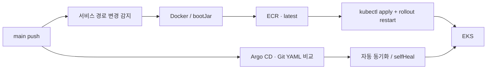

<div align="center">

# 🛒 yjeee-deployshop

### AWS Cloud-Native MSA · DevOps Engineering Portfolio

**Terraform IaC · Amazon EKS · CI/CD · GitOps · Monitoring**

`Infrastructure` → `Deployment` → `Autoscaling` → `Observability` → `Validation`

</div>

---

> 회원·상품·주문 서비스의 AWS EKS 배포와 인프라 구축·자동 배포·자동 확장·모니터링·주문 검증을 연결한 DevOps 포트폴리오.

| 📚 문서 | 내용 |
| :--- | :--- |
| [구축 절차](docs/SETUP.md) | 실행 순서, CLI·콘솔 작업, Terraform 관리 범위 |
| [실행 및 검증 결과](docs/VALIDATION.md) | 실행 설명·강조 캡처·확인 포인트·결과를 한 문서에서 확인 |
| [문제 분석 및 해결](docs/TROUBLESHOOTING.md) | Grafana OOM·EBS, HPA·Argo CD 충돌, 인증서 충돌 해결 |
| [핵심 개념 복습](docs/learning/CORE-REVIEW.md) | 개인 프로젝트의 기술 선택 이유와 동작 원리 |
| [교육·복습 노트](docs/learning/STUDY-NOTES.md) | 단계별 명령·의미·정상 결과·오류 해결 및 EBS 상세 설명 |

[전체 문서 보기](docs/README.md)

## 01. System Architecture


[상세 아키텍처 보기](docs/ARCHITECTURE.md)

Route 53으로 DNS 조회 → Frontend 로드 → 같은 도메인의 API 경로로 요청. Terraform·CLI·콘솔별 관리 범위는 [구축 절차](docs/SETUP.md)에서 확인.

### 직접 수행한 범위와 기술 선택

직접 수행: **인프라 구성·배포 연결·운영 문제 해결·실행 검증**. 회원·상품·주문 애플리케이션은 수업 제공 코드 기반.

| 선택 | 프로젝트에서의 목적 |
|---|---|
| Terraform / EKS | AWS 기본 자원 모듈화와 서비스별 컨테이너 배포·확장 실습 |
| Actions / Argo CD | 변경 서비스 이미지 배포와 Git 선언 상태 복구. 현재 직접 배포와 GitOps 혼용 |
| HPA / Cluster Autoscaler | Pod와 노드 용량을 각각 제어 |
| Prometheus / Grafana / EBS | 앱·노드 메트릭 관찰과 Grafana 설정 보존 |

## 02. Core Services & Tools

| 서비스 | 역할 | 이미지 저장소 |
| :--- | :--- | :--- |
| 👤 Member | 회원가입·중복 검사·로그인·JWT | `member-service` |
| 📦 Product | 상품 등록·조회·재고 차감·S3 이미지 | `product-service` |
| 🛒 Ordering | 상품 서비스 호출·재고 검사·주문 저장 | `ordering-service` |
| 🌐 API Gateway | 경로 라우팅·JWT 검증·사용자 정보 전달 | `apigateway` |
| 🖥️ Frontend | 쇼핑몰 정적 화면 제공 | `frontend-service` |

| 영역 | 사용 기술 |
| :--- | :--- |
| Cloud / IaC | AWS · Terraform Root + Child Modules · Local State |
| Container / Network | Docker · ECR · EKS · Ingress NGINX · NLB · Route 53 · cert-manager |
| Delivery | GitHub · GitHub Actions · Argo CD |
| Scaling | Metrics Server · CPU 기반 HPA · Cluster Autoscaler |
| Monitoring / Storage | Prometheus · Node Exporter · Actuator / Micrometer · Grafana · EBS CSI / PVC · CloudWatch · SNS |
| 실습 / 검증 | Windows · PowerShell · VS Code · Postman · MySQL Workbench |

## 03. CI/CD & GitOps



- **Actions:** 변경 서비스 이미지 빌드·ECR 업로드 → kubectl 직접 배포. `latest` 태그·`MUTABLE` 저장소 사용.
- **Argo CD:** `msa-root`로 하위 Application 관리, Git 매니페스트와 실제 상태 동기화.
- **replicas 제어:** Backend는 HPA 관리·Argo CD 비교 제외, Frontend는 Git의 `replicas: 1` 유지.

이미지 태그의 Git 자동 갱신은 미구현.

## 04. 실행 및 검증 결과

| 검증 | 확인 결과 |
| :--- | :--- |
| 주문·재고 | 웹·API 순차 구매 후 `10 → 9 → 7`, 초과 주문 `400`·기존 데이터 유지 |
| HPA·CA | 상품 Pod `1 → 5 → 1`, 노드 `2 → 3` 확장 |
| 메트릭 | 노드·앱 Targets `UP`·`up=1`, Grafana 패널 표시 |
| 로그·알림 | EKS 제어 영역 로그 수집, 수동 ALARM → SNS 이메일 전달·OK 복귀 |

실행 과정·강조 캡처·확인 포인트: [실행 및 검증 결과](docs/VALIDATION.md).

## 05. 문제 분석 및 해결

| 문제 | 조치와 결과 |
| :--- | :--- |
| Grafana OOM·설정 소실 | 메모리 조정·EBS PVC 연결 → 재시작 후 설정 유지 |
| HPA·Argo CD 제어 충돌 | replicas 관리 분리 → 자동 확장·축소 유지 |
| Certificate 반복 OutOfSync | 중복 생성 설정 제거 → 동기화·HTTPS 정상 |

증상·원인·설정 변경: [문제 분석 및 해결](docs/TROUBLESHOOTING.md).

## 06. Repository Structure

```text
yjeee-deployshop/
├── .github/workflows/            # 이미지 빌드 및 직접 배포
├── apps/                        # 서비스 소스·Dockerfile
│   ├── apigateway/
│   ├── frontend/
│   ├── member/
│   ├── ordering/
│   └── product/
├── deploy/
│   ├── argocd/                  # root / 하위 Application 선언
│   └── k8s/
│       ├── apps/                # 서비스별 Deployment·Service
│       └── platform/            # Ingress·인증서·HPA·CA·모니터링
├── terraform/                   # 여기서만 init / plan / apply
│   └── modules/                 # network·iam·eks·rds·ecr·s3
└── docs/
    ├── README.md                # 문서 목록
    ├── ARCHITECTURE.md
    ├── SETUP.md
    ├── VALIDATION.md
    ├── TROUBLESHOOTING.md
    ├── images/                  # 공개용 캡처 사본
    └── learning/                # 핵심 복습·상세 노트·체크리스트
```

## 07. Scope & Operations Notes

- **구축 범위:** Terraform으로 AWS 기본 자원·CloudWatch/SNS 관리. Route 53·일부 IAM·EBS CSI 연결은 콘솔 구성.
- **데이터·접근:** Single-AZ Public RDS·외부 PC `/32` 제한. Grafana EBS 영구 저장, Prometheus 영구 볼륨 미적용.
- **검증 범위:** 순차 주문·확장·상태 복구·수동 경보 전달 확인. 동시 주문·결제·실제 CPU 임계값 초과·AZ 장애 복구는 미검증.
- **보존·정리:** 인증값·State는 Git 추적 제외. 종료 시 EBS·RDS 스냅샷·S3 버전·로그 보호 설정 확인.

---

<div align="center">

**실제 실행 결과와 오류 해결 과정을 함께 기록한 DevOps 포트폴리오**

<sub>yjeee-deployshop · AWS MSA DevOps Portfolio</sub>

</div>
