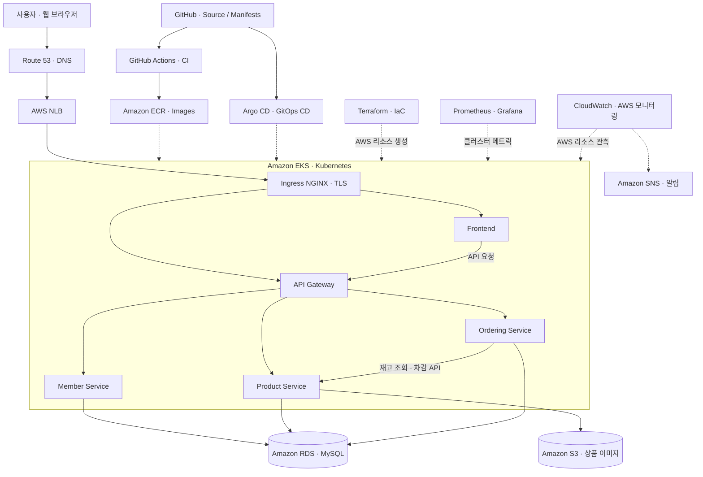
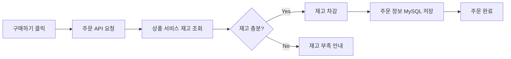

[README.md](https://github.com/user-attachments/files/33522135/README.md)
# yjeee-deployshop

**AWS 기반 MSA 온라인 주문 서비스 | DevOps Engineering Portfolio**

회원·상품·주문 기능을 갖춘 온라인 쇼핑몰을 AWS EKS에 배포하고, **Terraform 기반 인프라 자동화부터 CI/CD, GitOps, 모니터링, 서비스 검증까지** 구현하는 DevOps 포트폴리오 프로젝트입니다.

> **프로젝트 초점:** 쇼핑몰 비즈니스 로직 개발보다 **클라우드 인프라 구축, 컨테이너 오케스트레이션, 배포 자동화 및 운영 검증**에 중점을 둡니다.

## Architecture

## Online Shopping Service

| 서비스 | 제공 기능 |
| --- | --- |
| **Member** | 회원가입, 중복 검사, 로그인, JWT 인증 및 토큰 재발급 |
| **Product** | 상품 등록·목록·상세 조회, S3 이미지 업로드, 재고 관리 |
| **Ordering** | 구매 요청, 재고 확인·차감, 주문 데이터 저장 |
| **Frontend / API Gateway** | 웹 쇼핑몰 UI 및 마이크로서비스 API 요청 전달 |

### 주문 처리 프로세스

**핵심 동작:** 주문 서비스와 상품 서비스가 **내부 API로 통신**해 재고를 확인·차감하고, 주문 결과를 데이터베이스에 저장합니다. 재고가 부족하면 구매를 거절합니다.

> 재고 확인·차감은 구현되어 있으나, 동시 주문에 대한 별도의 락·원자적 재고 차감이나 서비스 간 분산 트랜잭션 보장까지 구현된 것으로 표기하지 않습니다.

## DevOps Stack & Tools

| 영역 | 기술 / 도구 | 활용 |
| --- | --- | --- |
| **Cloud / IaC** | AWS, Terraform | VPC·EKS·RDS·ECR·S3 등 인프라 코드화 |
| **Container / Orchestration** | Docker, Kubernetes (Amazon EKS) | 이미지 빌드 및 마이크로서비스 배포·관리 |
| **Networking / Security** | Route 53, NLB, Ingress NGINX, cert-manager | 도메인 연결, 라우팅 및 HTTPS |
| **CI/CD / GitOps** | GitHub, GitHub Actions, Argo CD | 소스 형상 관리, 빌드 및 배포 자동화 |
| **Monitoring** | Prometheus, Grafana | Pod·클러스터 메트릭 수집 및 시각화 |
| **AWS Monitoring / Alerting** | Amazon CloudWatch, Amazon SNS | AWS 리소스 모니터링 및 경보 알림 구성 대상 |
| **Development / Validation** | VS Code, Postman, MySQL Workbench | 인프라 코드 작업, API 테스트 및 DB 데이터 확인 |

## 주문 시스템 검증

**온라인 웹사이트 → Postman → MySQL Workbench**를 연결해 사용자 동작부터 API 응답, 실제 DB 반영까지 확인합니다.

| 검증 환경 | 확인 항목 |
| --- | --- |
| **온라인 쇼핑몰** | 회원 로그인, 상품 목록·상세 표시, 구매 버튼 및 주문 결과 |
| **Postman** | 회원 인증·상품 조회·주문 생성 API, 성공·재고 부족 응답 |
| **MySQL Workbench** | MySQL의 회원·상품·주문 데이터 조회, 주문 레코드 생성 및 재고 차감 결과 |

주문 전후 **상품 재고 수량과 주문 테이블의 데이터를 비교**하여 웹 UI, API, DB 간 동작을 검증합니다.

## Operations & Monitoring

- **Prometheus / Grafana:** Kubernetes 워크로드 및 클러스터 메트릭 관측
- **CloudWatch:** AWS 리소스 지표·상태 모니터링 및 경보 구성
- **SNS:** CloudWatch 경보 발생 시 알림 전달을 위한 연동

> CloudWatch 경보 및 SNS 알림은 최종 모니터링·검증 단계의 **구성/검증 대상**이며, 실제 경보 전달 테스트 완료 여부는 별도로 확인해야 합니다.

---

**Goal:** `Terraform IaC → EKS Deployment → CI/CD & GitOps → Monitoring → End-to-End Validation`
