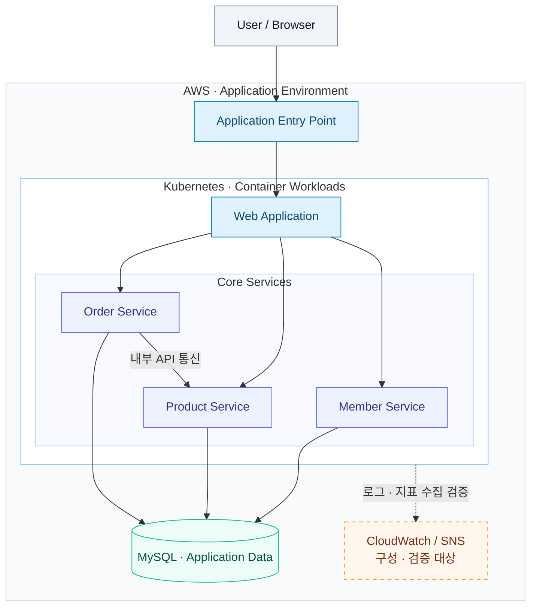
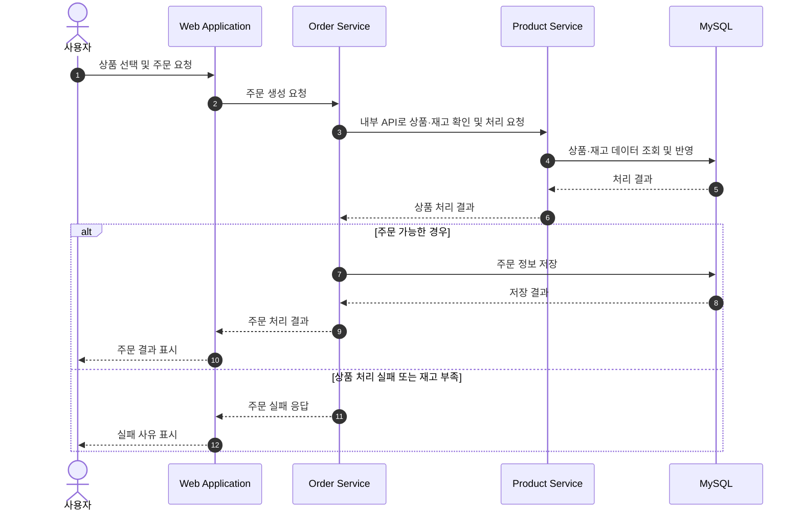

[README.md](https://github.com/user-attachments/files/33522366/README.md)

# yjeee-deployshop

### AWS 기반 MSA 쇼핑몰 · DevOps Portfolio

서비스 개발부터 컨테이너 배포, 인프라 구성, 주문 흐름 검증까지 연결하는 프로젝트

  
  
  
  

**Infrastructure as Code · Container Deployment · End-to-End Validation**

---

쇼핑몰의 상품 조회와 주문을 소재로, **AWS 인프라 위에서 여러 서비스를 배포하고 전체 요청 흐름을 확인하는 DevOps 포트폴리오**입니다. 기능 구현과 함께 인프라 재현성, 서비스 간 연결, 데이터 반영, 운영 관점의 검증을 다룹니다.

> **Portfolio Focus**  
> 인프라 구성 → 컨테이너 배포 → 내부 API 연결 → 주문 및 데이터 확인 → 운영 검증

## 01 · System Architecture

사용자 요청, 서비스 처리, 데이터 저장을 계층별로 구분한 논리 구성도입니다. 세부 AWS 리소스와 실제 배포 설정은 인프라 코드 및 배포 구성에서 확인합니다.

### Architecture 구성 요소

| 구성 요소 | 역할 |
| :--- | :--- |
| **AWS** | 애플리케이션과 인프라를 구성하는 클라우드 환경 |
| **Application Entry Point** | 사용자 요청이 애플리케이션으로 들어오는 진입 경로 |
| **Web Application** | 상품 조회와 주문 등 사용자 인터페이스 제공 |
| **Kubernetes / Docker** | 컨테이너 기반 서비스 배포 및 실행 환경 관리 |
| **Core Services** | 회원·상품·주문 책임을 나누고 내부 API로 연결 |
| **MySQL** | 회원·상품·주문 데이터의 영속 저장소; 도식은 논리적 저장 계층을 표현 |
| **Terraform** | 인프라 구성을 코드로 관리하고 재현 가능한 환경 구성 지원 |
| **CloudWatch / SNS** | 로그·지표 수집과 알림 연계를 위한 **구성 및 검증 대상** |

## 02 · Core Services

| Service | 주요 책임 | 확인할 연결 지점 |
| :--- | :--- | :--- |
| **Member** | 회원 정보와 사용자 식별에 필요한 데이터 관리 | 사용자 요청과 회원 데이터 연결 |
| **Product** | 상품 정보 및 재고 관련 처리 | 상품 조회와 주문 시 상품 정보 확인 |
| **Order** | 주문 요청 처리와 주문 데이터 관리 | 내부 API 통신, 처리 결과 및 데이터 반영 |

> **핵심 관점 — 서비스 간 연결**  
> 주문은 화면의 버튼 동작을 넘어, 내부 API 요청과 데이터 저장으로 이어집니다. 각 서비스의 처리 결과가 최종 응답과 저장 데이터에 일관되게 반영되는지 확인합니다.

## 03 · Order Processing Flow

주문 요청부터 결과 확인까지의 핵심 흐름입니다. 오류 응답, 재고 부족, 동시 주문의 정합성은 아래 검증 항목에서 함께 다룹니다.

**검증 포인트:** 화면 응답뿐 아니라 주문 저장 결과, 재고 반영, 서비스 간 오류 전달을 함께 확인합니다. 분산 처리 중 실패 복구 방식과 동시성 제어의 보장 수준은 별도 구현 및 검증 근거가 필요합니다.

## 04 · Tech Stack & Tools

| 영역 | 기술 및 도구 | 활용 목적 |
| :--- | :--- | :--- |
| **Cloud** | AWS | 클라우드 인프라 및 서비스 실행 환경 구성 |
| **Infrastructure as Code** | Terraform | 인프라 정의와 변경 이력 관리 |
| **Container** | Docker | 애플리케이션 이미지 구성 및 실행 |
| **Orchestration** | Kubernetes | 서비스 배포 및 워크로드 상태 관리 |
| **Service Communication** | 내부 API 통신 | 서비스 간 요청과 응답 연결 |
| **Database** | MySQL | 애플리케이션 데이터 저장 |
| **Development** | VS Code | 코드·인프라·배포 설정 편집 |
| **API Validation** | Postman | API 요청, 응답 및 오류 시나리오 확인 |
| **Database Validation** | MySQL Workbench | 저장 데이터와 주문·재고 반영 결과 확인 |
| **Version Control** | GitHub | 소스 코드와 인프라·배포 구성 이력 관리 |
| **Observability** | CloudWatch / SNS | 로그·지표·알림 연계 **구성 및 검증 대상** |

## 05 · End-to-End Validation

**사용자 요청 → 서비스 간 통신 → 데이터 반영 → 최종 응답**을 하나의 흐름으로 확인합니다.

| 검증 영역 | 확인 내용 | 확인 수단 |
| :--- | :--- | :--- |
| **사용자 흐름** | 상품 조회부터 주문 결과 표시까지 연결되는지 확인 | 브라우저 |
| **API 연결** | 정상 요청, 잘못된 입력, 서비스 오류의 응답 확인 | Postman |
| **데이터 반영** | 주문 저장 결과와 상품·재고 변경 확인 | MySQL Workbench |
| **동시 주문** | 동일 상품의 동시 구매 시 재고 초과 판매와 데이터 충돌 여부 검증 | 동시 요청 및 DB 결과 대조 |
| **배포 상태** | 워크로드 실행 상태와 서비스 접근 경로 확인 | Kubernetes 상태 및 애플리케이션 응답 |
| **장애 상황** | 내부 API 실패 시 오류 전달 및 데이터 불일치 여부 확인 | 실패 시나리오와 로그·DB 대조 |

> 이 표는 **검증 범위**를 나타냅니다. 동시성 보장, 장애 복구, 성능 수치 등의 완료 여부는 실제 테스트 결과와 증적을 기준으로 판단합니다.

## 06 · Monitoring & Operations

운영 관점에서는 **서비스 상태 → 요청 처리 로그 → 데이터 결과**를 연결해 문제 지점을 추적합니다.

| 운영 항목 | 확인 방향 |
| :--- | :--- |
| **Workload Health** | Kubernetes 워크로드 상태, 재시작 여부, 서비스 접근 상태 확인 |
| **Application Logs** | 주문 처리 및 내부 API 통신의 오류 지점 확인 |
| **Configuration History** | Terraform과 배포 설정의 변경 사항을 GitHub 이력으로 관리 |
| **CloudWatch** | 로그·지표 수집 경로와 조회 가능 여부 **구성 및 검증 대상** |
| **SNS** | 알림 전달 경로 및 테스트 알림 수신 여부 **구성 및 검증 대상** |

---

**yjeee-deployshop**  
AWS 인프라와 서비스 배포, 주문 흐름 검증을 연결하는 DevOps 포트폴리오

