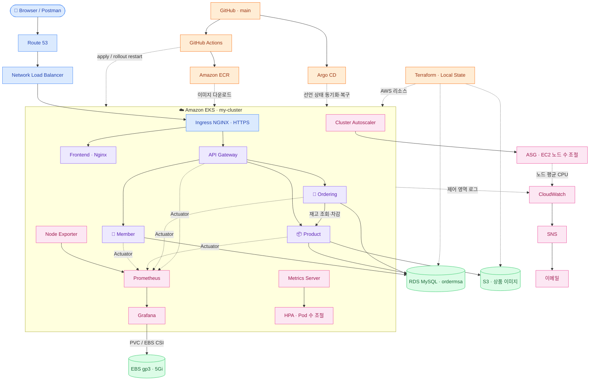

**DEPLOYSHOP · ARCHITECTURE**

# 상세 아키텍처

> 요청·배포·관측·인프라 관리 경로.

[문서 목록](README.md) · [구축 절차](SETUP.md) · [실행 결과](VALIDATION.md)

---

## 01. 전체 연결 구조

---

## 02. 배치와 접근

| 대상 | 배치·접근 방식 |
| :--- | :--- |
| **웹·API** | 같은 도메인의 API 요청 → Ingress → Gateway |
| **워커 노드** | Private App Subnet 배치·NAT 외부 통신 |
| **RDS** | Public 접근 유지·외부 PC `/32` 제한·EKS 보안 그룹 별도 허용 |
| **Private DB Subnet** | 정의만 존재·현재 RDS 배치에 미사용 |
| **Grafana 데이터** | EBS gp3 5Gi·PVC·같은 AZ 내 재연결 |

---

## 03. 관리 범위

| 관리 주체 | 대상 |
| :--- | :--- |
| **Terraform** | VPC·IAM·EKS·RDS·ECR·S3·CloudWatch/SNS·Local State |
| **CLI·콘솔** | Ingress NGINX·cert-manager·Argo CD·Metrics Server·Route 53·IRSA·EBS CSI 연결 |
| **Kubernetes Controller** | LoadBalancer Service → NLB / StorageClass·PVC → EBS |
| **Actions·Argo CD** | 이미지 직접 배포 / Git 선언 동기화·self-heal |

> **제어 분리** · HPA는 Backend replicas를, CA는 노드 용량을 조절합니다. Argo CD는 나머지 배포 선언을 관리합니다.
