# 구현 및 검증 사례

**무엇을 실행·변경했고, 어떤 화면을 통해 결과를 확인했는지**를 사례별로 정리했습니다. 캡처의 관찰 결과와 캡처가 없는 실행 보고를 구분했습니다. 검증 기준일은 **2026-10-16**이며 현재 서비스 가동 상태를 뜻하지 않습니다.

| 사례 | 실행·변경 | 확인한 결과 |
|---|---|---|
| [이미지 빌드·배포](#01-이미지-빌드배포) | Actions로 이미지 빌드·ECR push·배포 | Workflow 성공, 서비스 정상 확인은 별도 실행 보고 |
| [선언 상태 복구](#02-git-선언-상태-복구) | Frontend를 수동으로 2개로 변경 | Git의 1개로 복귀 |
| [자동 확장·축소](#03-부하에-따른-pod노드-확장과-pod-축소) | 상품 조회 부하 생성 후 제거 | Pod 1→5→1, 확장 시 Ready 노드 3개 |
| [주문·재고 검증](#04-웹api-주문과-db-결과-대조) | 웹·API 주문 후 DB 재조회 | 재고 10→9→7, 초과 주문 거절 후 데이터 유지 |
| [메트릭 수집·시각화](#05-메트릭-수집과-시각화) | 앱·노드 수집 경로 구성 | Targets UP, up=1, Grafana 패널 표시 |
| [Grafana 문제 해결](#06-grafana-종료-원인-분석과-설정-보존) | 메모리 조정·EBS PVC 추가 | OOM 원인은 캡처, 재시작 후 보존은 실행 보고 |
| [경보·알림 전달](#07-cloudwatch-상태-변경과-sns-알림-전달) | ALARM 상태 수동 전환 | 경보 메일과 ALARM·OK 이력 |
| [DB 접근 범위 제한](#08-db-접근-범위-제한-후-재접속) | 외부 MySQL 출발지를 PC /32로 변경 | SG 규칙 확인, Workbench 재접속·조회 |

## 01. 이미지 빌드·배포

| 단계 | 실행·확인 내용 | 캡처에서 볼 부분 |
|---|---|---|
| 준비 | Actions에서 사용할 AWS 인증값 등록 | [Repository Secrets](images/evidence-33.png) |
| 실행 | Workflow에서 서비스 이미지 build·push·apply·restart 수행 | [Workflow 실행 결과](images/evidence-34.png)의 build-and-deploy 성공 |

**검증 결과:** Actions의 빌드·배포 작업이 성공했습니다. 이후 서비스별 rollout과 쇼핑몰 조회 정상은 사용자가 확인·보고했습니다.

**확인 범위:** Workflow 성공만으로 실제 구매 기능까지 증명하지 않습니다. 실제 요청·DB 결과는 04번 사례에서 따로 대조합니다.

실행과 결과 캡처 펼쳐 보기

**Workflow 실행 결과 — 작업 성공 표시**

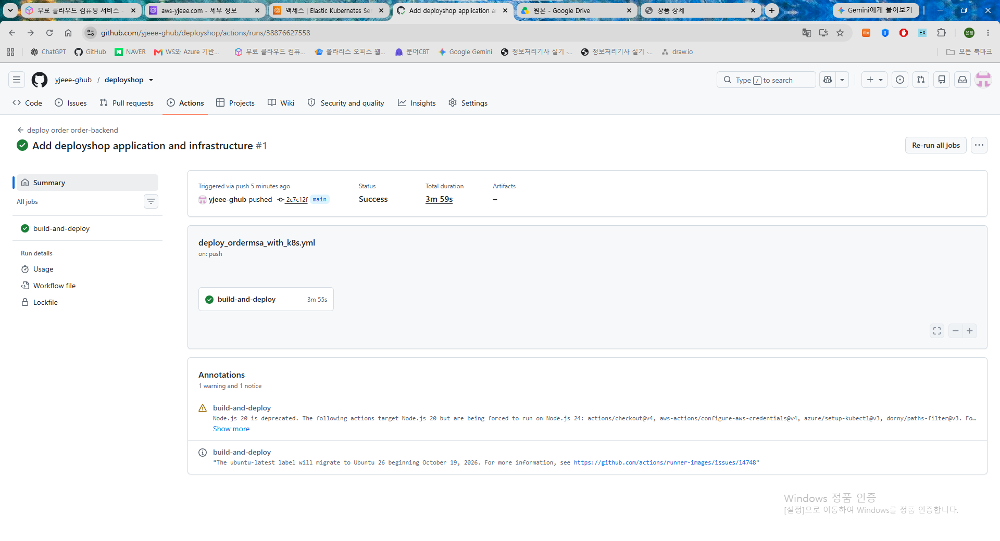

## 02. Git 선언 상태 복구

| 단계 | 실행·확인 내용 | 캡처에서 볼 부분 |
|---|---|---|
| 변경 | Frontend replicas를 수동으로 2개로 변경 | [수동 scale 명령](images/evidence-01.png) |
| 관찰 | Deployment 변화와 Argo CD 상태 확인 | [watch 출력·최종 replicas](images/evidence-02.png)의 1/1 복귀 |

**검증 결과:** 수동으로 바꾼 Pod 수가 Git의 replicas 1로 복구되는 것을 확인했습니다.

**확인 범위:** [Argo CD 전체 화면](images/evidence-03.png)은 monitoring OutOfSync가 남은 중간 시점입니다. 최종 전체 Synced·Healthy는 별도 사용자 보고이며 이 화면을 최종 정상 증거로 사용하지 않습니다.

실행과 결과 캡처 펼쳐 보기

**변경 — replicas 2로 수동 조정**

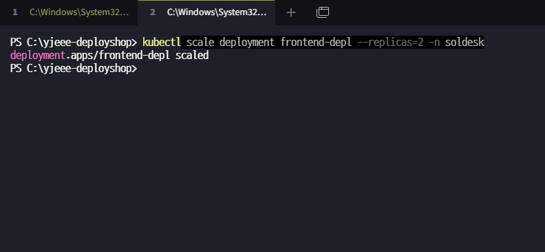

**결과 — Deployment가 1/1로 복귀**

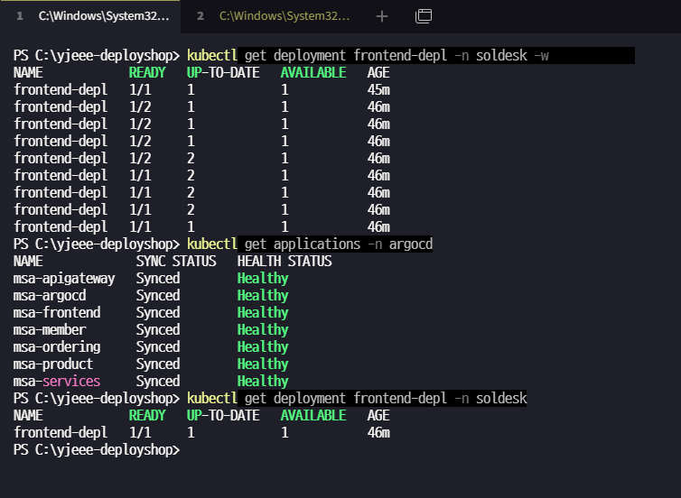

## 03. 부하에 따른 Pod·노드 확장과 Pod 축소

| 단계 | 실행·확인 내용 | 캡처에서 볼 부분 |
|---|---|---|
| 부하 생성 | 상품 목록 반복 조회 루프 8개 실행 | [부하 명령·HPA 변화](images/evidence-05.png)의 replicas 1→2→4→5 |
| 확장 관찰 | 상품 Pod 배치와 노드 상태 조회 | [확장 결과](images/evidence-05.png)의 상품 Pod 5개·Ready 노드 3개 |
| 부하 제거 | product-load 삭제 후 HPA 변화 관찰 | [축소 결과](images/evidence-06.png)의 CPU 감소·replicas 5→1 |

**검증 결과:** 상품 조회 부하에 따른 Pod 확장·축소와 확장 시점의 노드 증가를 확인했습니다. CA의 AWS 권한 연결은 [설정 화면](images/evidence-04.png)에 있습니다.

**확인 범위:** 노드 2→3은 실행 기록, 캡처에는 확장 시점 3개가 보입니다. 3→2 축소는 사용자 완료 보고이며 해당 노드 목록 캡처는 없습니다. 처리량 개선율·SLA를 측정한 테스트는 아닙니다.

실행과 결과 캡처 펼쳐 보기

**부하 생성·확장 — HPA replicas 증가와 노드 목록**

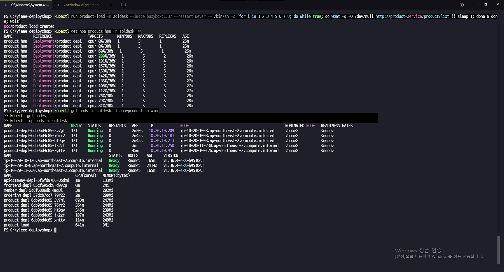

**부하 제거·축소 — product-load 삭제 후 replicas 감소**

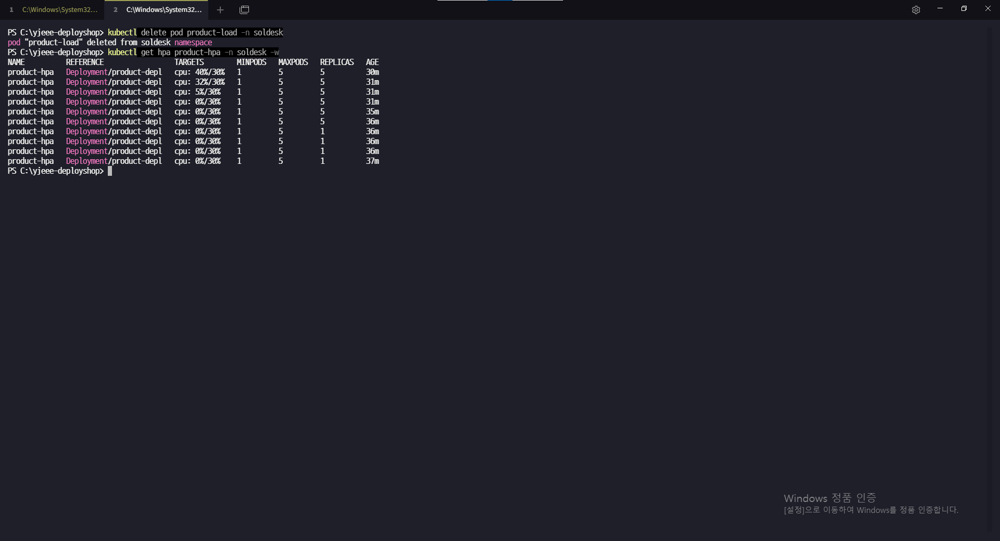

## 04. 웹·API 주문과 DB 결과 대조

| 단계 | 실행·확인 내용 | 캡처에서 볼 부분 |
|---|---|---|
| 초기 상태 | 상품 ID 2를 재고 10개로 준비 | [초기 DB 조회](images/evidence-08.png)·[상품 화면](images/evidence-07.png) |
| 웹 주문 | 1개 구매 후 같은 상품 재조회 | [구매 완료](images/evidence-14.png)·[DB 재고](images/evidence-15.png)·[주문 기록](images/evidence-16.png) |
| API 주문 | 같은 상품 2개 주문 | [Postman 201·주문 ID 4](images/evidence-19.png)·[재고 7](images/evidence-20.png)·[주문 2건](images/evidence-21.png) |
| 초과 주문 | 남은 재고 7개에서 8개 주문 후 DB 재조회 | [400·재고 부족](images/evidence-10.png)·[재고 7 유지](images/evidence-11.png)·[주문 2건 유지](images/evidence-12.png) |

**검증 결과:** 웹 1개와 API 2개 주문 후 재고 10→9→7, 주문 ID 3·4를 확인했습니다. 초과 주문은 거절됐고 기존 재고·주문이 유지됐습니다. [웹 재조회](images/evidence-09.png)·[추가 화면](images/evidence-13.png)도 함께 남겼습니다.

**확인 범위:** 동일 상품 ID 2의 순차 기능 검증입니다. [ID 1의 초기 구매·상세 화면](images/evidence-41.png)과 섞지 않습니다. 동시 주문 정합성·결제·분산 트랜잭션 보장을 검증한 것은 아닙니다.

실행과 결과 캡처 펼쳐 보기

**API 주문 — 상품 ID 2·수량 2 요청과 201 응답**

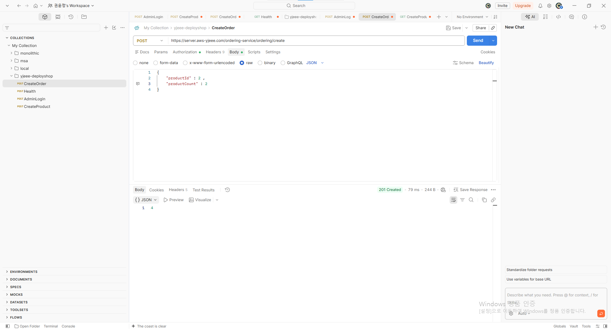

**초과 주문 거절 후 — 기존 주문 ID 3·4만 유지**

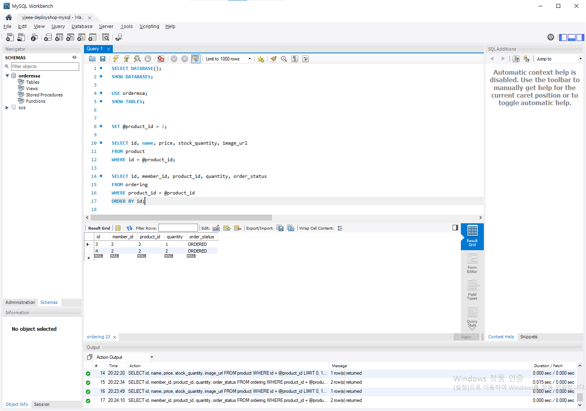

상품 이미지 연결은 [S3 객체](images/evidence-45.png)와 [상품 상세](images/evidence-42.png)·[추가 상세](images/evidence-43.png)를 통해 확인했습니다. [웹 로그인](images/evidence-44.png), [상품 API 응답](images/evidence-18.png)은 기능 확인의 보조 자료입니다.

## 05. 메트릭 수집과 시각화

| 단계 | 실행·확인 내용 | 캡처에서 볼 부분 |
|---|---|---|
| 수집 구성 | Node Exporter와 앱 Actuator 수집 경로 연결 | [Targets](images/evidence-38.png)의 node-exporter·spring-apps UP |
| 수집 확인 | up 쿼리로 대상별 수집 상태 조회 | [up 쿼리](images/evidence-39.png)·[추가 결과](images/evidence-40.png)의 값 1 |
| 시각화 | Grafana에서 노드·앱 메트릭 패널 확인 | [노드 지표](images/evidence-36.png)·[앱 지표](images/evidence-37.png) |

**검증 결과:** 노드·앱 메트릭을 수집하고 CPU·메모리·HTTP 요청 등을 시각화했습니다.

**확인 범위:** up=1은 수집 성공입니다. 업무 기능 정상 여부는 별도 검증합니다. 노드 수는 캡처 시점에 따라 다르므로 부하 테스트 화면과 같은 시점으로 합치지 않습니다.

실행과 결과 캡처 펼쳐 보기

**수집 상태 — Prometheus Targets UP**

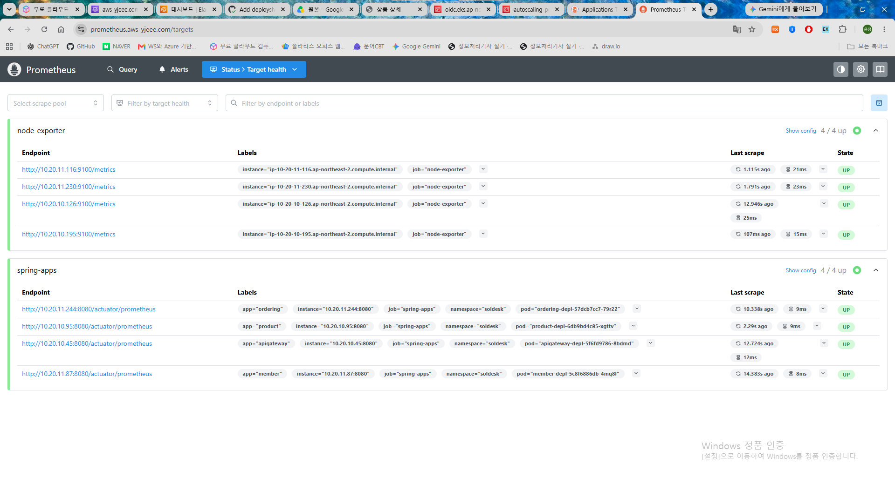

**시각화 — Grafana 앱 메트릭**

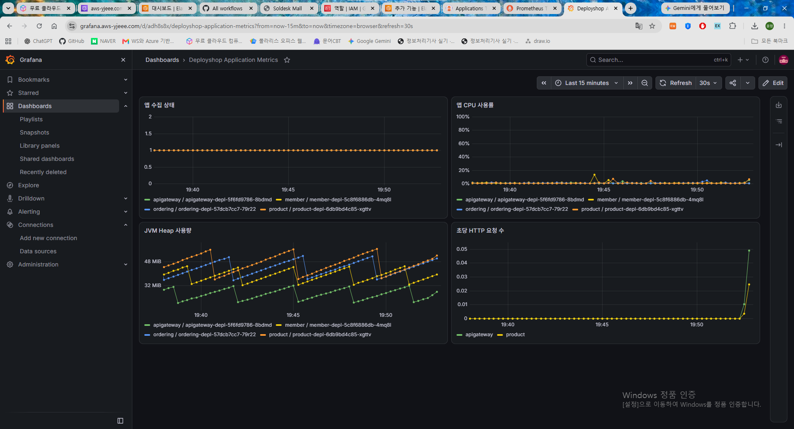

## 06. Grafana 종료 원인 분석과 설정 보존

| 단계 | 실행·확인 내용 | 캡처에서 볼 부분 |
|---|---|---|
| 증상·진단 | 재로그인 후 계정·대시보드 설정 소실, 종료 상태 조회 | [종료 원인 출력](images/evidence-35.png)의 OOMKilled·ExitCode 137·restartCount 1 |
| 조치 | 메모리 한도 500Mi→1Gi, /var/lib/grafana에 EBS PVC 연결 | [문제 분석 및 해결](TROUBLESHOOTING.md#1-grafana-oomkilled와-설정-소실)의 설정·변경 근거 |
| 재검증 | 설정 재저장 후 rollout restart, 계정·데이터 소스·대시보드 확인 | 사용자 실행 완료 보고 — 전후 비교 캡처 없음 |

**검증 결과:** 메모리 부족과 저장소 부재를 분리해 조치했습니다. 재시작 후 설정 유지는 사용자 실행 보고로 확인했습니다.

**확인 범위:** 기존 Grafana 대시보드 캡처를 재시작 후 데이터 보존의 증거로 바꿔 해석하지 않습니다. EBS 연결·보존 성공 비교 캡처는 없습니다.

실행과 결과 캡처 펼쳐 보기

**진단 근거 — OOMKilled와 종료 코드 확인**

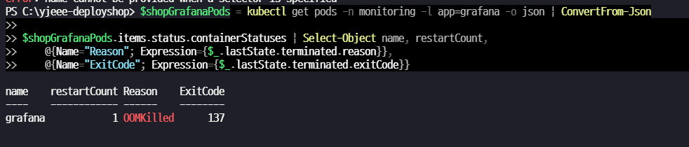

## 07. CloudWatch 상태 변경과 SNS 알림 전달

| 단계 | 실행·확인 내용 | 캡처에서 볼 부분 |
|---|---|---|
| 경보 구성 | ASG 평균 CPU 경보와 SNS 연결 | [경보 설정](images/evidence-25.png)·[추가 설정](images/evidence-26.png)·[상태 화면](images/evidence-27.png) |
| 경로 테스트 | set-alarm-state로 ALARM 상태 수동 전환 | [테스트 명령](images/evidence-28.png)의 Manual notification path test |
| 결과 확인 | 경보 메일과 상태 변경·액션 이력 확인 | [ALARM 메일](images/evidence-29.png)·[ALARM/OK 이력](images/evidence-30.png) |

**검증 결과:** CloudWatch 상태 변경→SNS→이메일 전달 경로를 확인했습니다. EKS 제어 영역 로그는 [로그 스트림](images/evidence-32.png)에서 확인했습니다.

**확인 범위:** CPU 80% 이상을 실제로 10분 유지한 부하 검증이 아닙니다. OK 이메일 수신은 사용자 보고입니다. [SNS 직접 게시 메일](images/sns-email-redacted.png)은 AI 가림 설명용 사본으로 원본 증거와 구분합니다.

실행과 결과 캡처 펼쳐 보기

**실행 — ALARM 상태 수동 전환 명령**

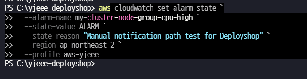

**결과 — CloudWatch 상태 변경·액션 이력**

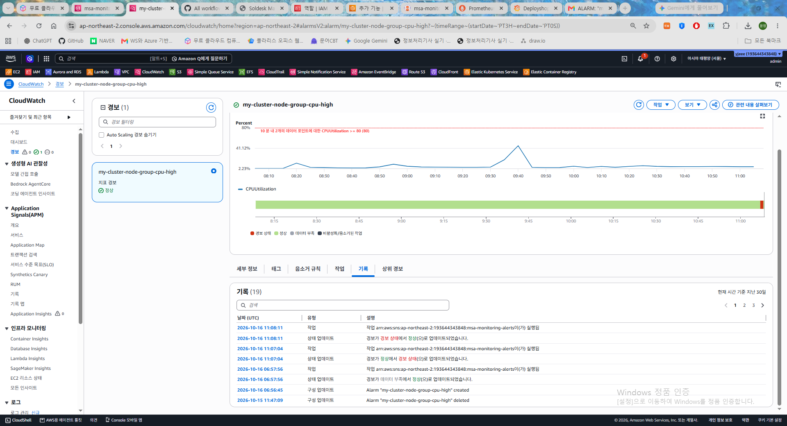

## 08. DB 접근 범위 제한 후 재접속

| 단계 | 실행·확인 내용 | 캡처에서 볼 부분 |
|---|---|---|
| 변경 | Workbench 외부 MySQL 허용 범위를 PC 공인 IP /32로 수정·적용 | [입력값 변경](images/evidence-22.png) |
| 설정 확인 | RDS 보안 그룹에서 /32와 EKS SG 규칙 확인 | [보안 그룹](images/evidence-24.png)의 3306 접근 규칙 |
| 재접속 | 변경 후 Workbench 연결·조회 확인 | [재조회 화면](images/evidence-23.png)과 사용자 완료 보고 |

**검증 결과:** 외부 PC 접근 범위를 제한한 상태에서 DB 조회가 가능함을 확인했습니다.

**확인 범위:** RDS Public 접근은 유지합니다. Private RDS 구축이나 허용하지 않은 모든 출발지의 접속 거부 시험을 완료한 것으로 설명하지 않습니다.

실행과 결과 캡처 펼쳐 보기

**접근 제한 — RDS 보안 그룹의 허용 출발지 확인**

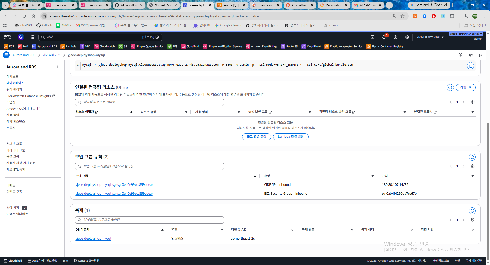

## 검증 기록 읽는 기준

- **실행 검증 결과:** [VALIDATION](VALIDATION.md)은 상품·주문 값과 확인 범위를 정리한 기준 문서입니다. 이 페이지는 실행·관찰·결과를 캡처로 연결합니다.
- **AI 편집 사본:** `login-redacted.png`와 `sns-email-redacted.png`는 비밀번호·토큰·구독 해지 링크 등을 가린 설명용 사본입니다. UI·해상도 등이 원본과 달라질 수 있어 원본 그대로의 증거로 취급하지 않습니다. [로그인 설명용 사본](images/login-redacted.png)
- **원본 보존:** 제공된 PNG 45개 중 일반 캡처 43개는 내용 변경 없이 복사했습니다. 민감 정보가 있는 원본 2개는 저장소에 복사하지 않았습니다. 이번 작업에서는 이미지 내용을 수정하지 않았습니다.

전체 캡처와 원본 파일명 대응표

| 번호 | 제공한 원본 파일명 | 공개 사본 |
|---|---|---|
| 1 | ArgoCD replicas 복구 실습1.png | [캡처 보기](images/evidence-01.png) |
| 2 | ArgoCD replicas 복구 실습2.png | [캡처 보기](images/evidence-02.png) |
| 3 | ArgoCD.png | [캡처 보기](images/evidence-03.png) |
| 4 | Cluster Autoscaler가 ASG의 노드 수를 조절할 수 있도록 AWS 권한을 연결.png | [캡처 보기](images/evidence-04.png) |
| 5 | HPA 확장_부하테스트1.png | [캡처 보기](images/evidence-05.png) |
| 6 | HPA 확장_부하테스트2.png | [캡처 보기](images/evidence-06.png) |
| 7 | Postman_Workbench_test.png | [캡처 보기](images/evidence-07.png) |
| 8 | Postman_Workbench_test1.png | [캡처 보기](images/evidence-08.png) |
| 9 | Postman_Workbench_test10.png | [캡처 보기](images/evidence-09.png) |
| 10 | Postman_Workbench_test11.png | [캡처 보기](images/evidence-10.png) |
| 11 | Postman_Workbench_test11_1.png | [캡처 보기](images/evidence-11.png) |
| 12 | Postman_Workbench_test11_2.png | [캡처 보기](images/evidence-12.png) |
| 13 | Postman_Workbench_test11_3.png | [캡처 보기](images/evidence-13.png) |
| 14 | Postman_Workbench_test2.png | [캡처 보기](images/evidence-14.png) |
| 15 | Postman_Workbench_test3.png | [캡처 보기](images/evidence-15.png) |
| 16 | Postman_Workbench_test4.png | [캡처 보기](images/evidence-16.png) |
| 17 | Postman_Workbench_test5.png | [AI 가림 설명용 사본](images/login-redacted.png) |
| 18 | Postman_Workbench_test6.png | [캡처 보기](images/evidence-18.png) |
| 19 | Postman_Workbench_test7.png | [캡처 보기](images/evidence-19.png) |
| 20 | Postman_Workbench_test8.png | [캡처 보기](images/evidence-20.png) |
| 21 | Postman_Workbench_test9.png | [캡처 보기](images/evidence-21.png) |
| 22 | RDS의 공개 접근은 유지하면서 외부 PC의 MySQL 접속 허용 범위만 제한.png | [캡처 보기](images/evidence-22.png) |
| 23 | RDS의 공개 접근은 유지하면서 외부 PC의 MySQL 접속 허용 범위만 제한2.png | [캡처 보기](images/evidence-23.png) |
| 24 | RDS의 공개 접근은 유지하면서 외부 PC의 MySQL 접속 허용 범위만 제한3.png | [캡처 보기](images/evidence-24.png) |
| 25 | cloudewatch1.png | [캡처 보기](images/evidence-25.png) |
| 26 | cloudewatch2.png | [캡처 보기](images/evidence-26.png) |
| 27 | cloudewatch3.png | [캡처 보기](images/evidence-27.png) |
| 28 | cloudewatch_test1.png | [캡처 보기](images/evidence-28.png) |
| 29 | cloudewatch_test2.png | [캡처 보기](images/evidence-29.png) |
| 30 | cloudewatch_test3.png | [캡처 보기](images/evidence-30.png) |
| 31 | cloudwatch_구독이메일_메세지테스트.png | [AI 가림 설명용 사본](images/sns-email-redacted.png) |
| 32 | cloudwatch_로그스트림확인.png | [캡처 보기](images/evidence-32.png) |
| 33 | github1.png | [캡처 보기](images/evidence-33.png) |
| 34 | github2.png | [캡처 보기](images/evidence-34.png) |
| 35 | grafana_ommkilled오류 해결1.png | [캡처 보기](images/evidence-35.png) |
| 36 | grafana검증1.png | [캡처 보기](images/evidence-36.png) |
| 37 | grafana검증2.png | [캡처 보기](images/evidence-37.png) |
| 38 | prometheus_web검증.png | [캡처 보기](images/evidence-38.png) |
| 39 | prometheus_web검증2.png | [캡처 보기](images/evidence-39.png) |
| 40 | prometheus_web검증3.png | [캡처 보기](images/evidence-40.png) |
| 41 | shop_imag2.png | [캡처 보기](images/evidence-41.png) |
| 42 | shop_imag2_1.png | [캡처 보기](images/evidence-42.png) |
| 43 | shop_image1.png | [캡처 보기](images/evidence-43.png) |
| 44 | shop_image3.png | [캡처 보기](images/evidence-44.png) |
| 45 | shop_s3_object.png | [캡처 보기](images/evidence-45.png) |

