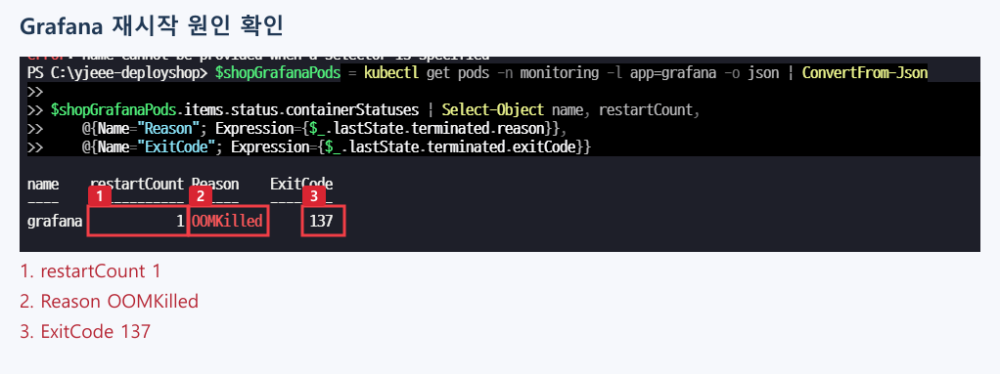
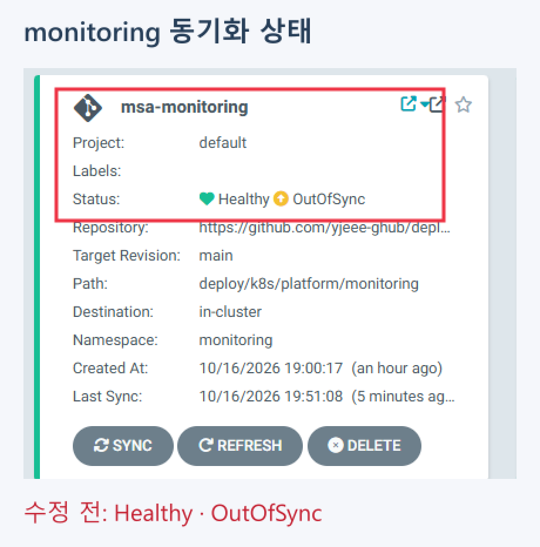
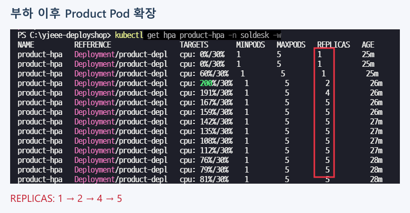
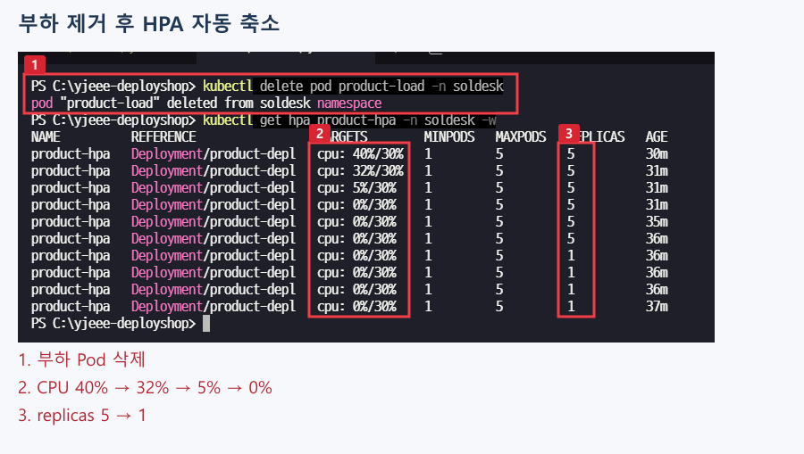
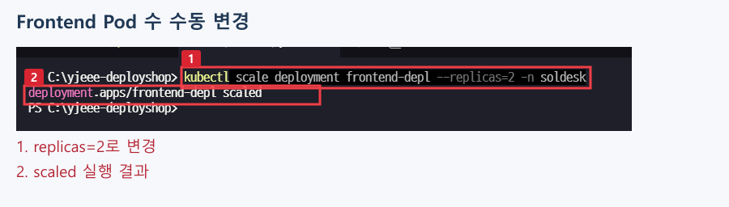
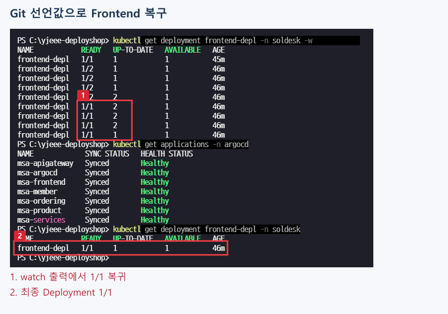
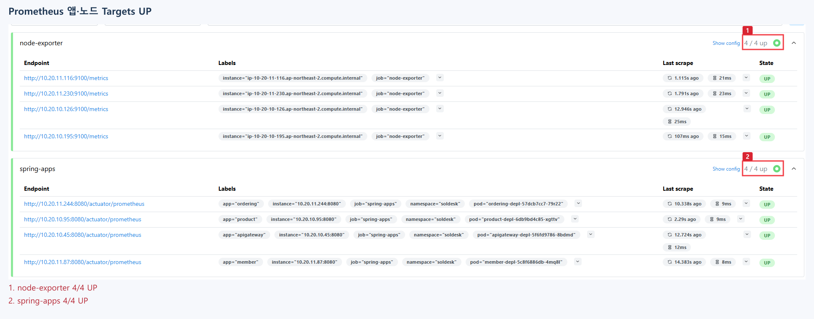
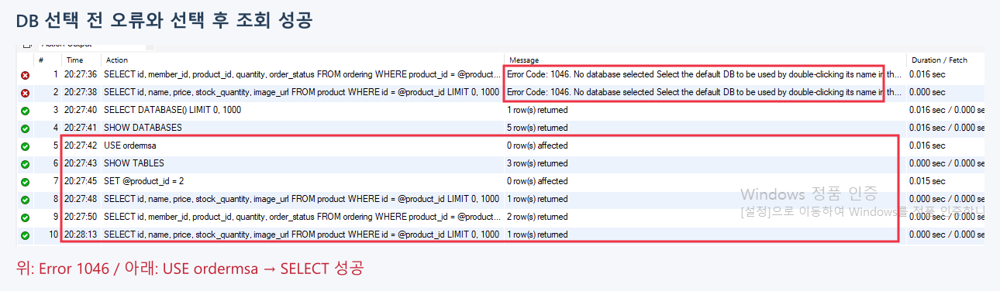

**DEPLOYSHOP · OPERATIONS**

# 문제 분석 및 해결

> 문제가 발생한 상황부터 원인 확인, 설정 변경, 조치 후 확인까지 정리했습니다.

| 문제 | 해결 방향 |
| :--- | :--- |
| **Grafana OOM·설정 소실** | 메모리 부족과 저장소 문제를 나누어 조치 |
| **Git에 추가한 PVC 미반영** | Argo CD가 참조하는 커밋 확인·갱신 |
| **Certificate 반복 OutOfSync** | 인증서 중복 관리 해소 |
| **HPA·Argo CD 제어 충돌** | replicas 관리 주체 분리 |
| **Prometheus Pending** | CPU request·노드 용량 확인 |
| **Argo CD CRD 설치 오류** | server-side apply 적용 |
| **Workbench Error 1046** | 접속과 기본 DB 선택을 구분 |

---

## 1. Grafana OOMKilled와 설정 소실

### 어떤 문제가 있었는지

Grafana가 재시작된 뒤 기존 계정과 데이터 소스, 대시보드를 다시 설정해야 했습니다. 먼저 컨테이너의 이전 종료 이력을 조회해 재시작 원인을 확인했습니다.



**캡처에서 확인한 내용**

- **①** `restartCount: 1` — 컨테이너 재시작 이력입니다.
- **②** `Reason: OOMKilled` — 메모리 부족에 따른 종료입니다.
- **③** `ExitCode: 137` — 종료 코드도 함께 확인했습니다.

### 원인을 어떻게 나눴는지

당시 메모리 limit은 `500Mi`였고, `/var/lib/grafana`에는 영구 볼륨이 연결되어 있지 않았습니다. 메모리 부족으로 종료된 문제와 재시작 후 설정이 사라지는 문제를 나누어 조치했습니다. 메모리만 늘려서는 설정을 보존할 수 없기 때문입니다.

### 어떻게 수정했는지

| 대상 | 변경 내용 |
| :--- | :--- |
| **메모리** | request `512Mi` / limit `1Gi` |
| **영구 저장** | EBS gp3 `5Gi` PVC를 `/var/lib/grafana`에 연결 |
| **배포 전략** | `Recreate`로 기존 Pod 종료 후 새 Pod 생성 |
| **파일 권한** | `fsGroup: 472` 적용 |
| **볼륨 생성·연결 권한** | EBS CSI 전용 IRSA 역할·애드온 연결 |

Grafana Deployment에 반영한 핵심 설정입니다.

```yaml
strategy:
  type: Recreate
# template.spec
securityContext:
  fsGroup: 472
  fsGroupChangePolicy: OnRootMismatch
# Grafana container
resources:
  requests:
    memory: "512Mi"
  limits:
    memory: "1Gi"
volumeMounts:
  - name: grafana-data
    mountPath: /var/lib/grafana
# template.spec
volumes:
  - name: grafana-data
    persistentVolumeClaim:
      claimName: grafana-data
```

### 조치 후 무엇을 확인했는지

PVC가 `Bound` 상태인지 확인한 뒤 계정·데이터 소스·대시보드를 다시 저장했습니다. 이후 Grafana를 재시작하고 변경한 계정으로 로그인해 설정이 유지되는지 확인했습니다.

> **결과** · 메모리 한도를 조정하고 영구 저장소를 연결했으며, 재시작 후 Grafana 설정 유지를 확인했습니다.

---

## 2. 새 PVC가 Git에 있는데 Argo CD에서 보이지 않음

### 어떤 문제가 있었는지

Grafana용 StorageClass와 PVC를 Git에 추가했지만 클러스터에는 PVC가 생성되지 않았습니다. 볼륨 바인딩을 확인하기 전에 Argo CD가 최신 변경을 읽고 있는지부터 확인했습니다.

### 무엇을 확인하고 수정했는지

스토리지를 추가한 커밋은 `3f8f591`이었지만 Argo CD는 이전 커밋 `2c7c12f`를 참조하고 있었습니다. 원격 커밋을 확인한 뒤 hard refresh로 갱신하고 최신 리비전을 Sync했습니다.

```powershell
kubectl annotate application msa-monitoring -n argocd argocd.argoproj.io/refresh=hard --overwrite
kubectl get application msa-monitoring -n argocd
kubectl get pvc -n monitoring
kubectl get pods -n monitoring
```

### 조치 후 무엇을 확인했는지

최신 리비전 반영 후 PVC 생성과 `Bound`, Grafana 배포를 확인했습니다. 이번에는 PVC 자체가 없었던 상황이므로, 이미 생성된 PVC가 `Pending`인 경우와 확인 순서가 달랐습니다.

> **결과** · Argo CD의 참조 리비전을 갱신한 뒤 PVC가 반영되었습니다. `WaitForFirstConsumer`에서는 Pod 배치 전 Pending이 정상 대기일 수 있으므로 Events도 함께 확인합니다.

---

## 3. monitoring Certificate가 계속 OutOfSync

### 어떤 문제가 있었는지

Argo CD에서 monitoring은 `Healthy`였지만 `OutOfSync`가 남아 있었습니다. 서비스가 실행되는 상태와 Git 선언이 일치하는 상태가 달라, Certificate의 차이 항목을 확인했습니다.



**캡처에서 확인한 내용**

- 빨간 박스의 `msa-monitoring`에 `Healthy`와 `OutOfSync`가 함께 표시됩니다.
- 이 화면은 인증서 설정을 수정하기 전 상태입니다.

### 원인을 어떻게 확인했는지

`duration: 2160h`, `renewBefore: 360h` 차이가 반복되었습니다. Git의 명시적 Certificate와 Ingress의 자동 인증서 생성 annotation이 같은 인증서를 관리하고 있었습니다.

### 어떻게 수정했는지

Ingress의 `cert-manager.io/cluster-issuer` annotation을 제거하고, 인증서는 Git에 선언한 Certificate로 관리하도록 정리했습니다. 기존 TLS Secret 참조와 issuer 설정은 유지했습니다.

Certificate에서 유지한 설정입니다.

```yaml
spec:
  secretName: monitoring-aws-yjeee-com-tls
  duration: 2160h
  renewBefore: 360h
  issuerRef:
    name: my-issuer
    kind: ClusterIssuer
```

### 조치 후 무엇을 확인했는지

변경을 반영한 뒤 Application의 Synced/Healthy와 HTTPS 정상 접속을 확인했습니다.

> **결과** · 같은 인증서를 두 경로에서 관리하던 설정을 정리해 반복되는 선언 차이를 해소했습니다.

---

## 4. HPA와 Argo CD의 replicas 제어 충돌

### 어떤 문제가 있었는지

HPA가 부하에 따라 Pod 수를 늘려도 Git에 선언된 수로 되돌아가는 문제가 있었습니다. HPA만 확인하는 대신 Argo CD의 selfHeal이 같은 필드를 다시 적용하는지 함께 확인했습니다.

### 원인을 어떻게 정리했는지

HPA는 CPU 사용률에 따라 replicas를 조정하고, Argo CD는 Git과 다른 값을 복구합니다. 두 컨트롤러가 Deployment의 `/spec/replicas`를 관리하면서 충돌했습니다.

### 어떻게 수정했는지

Backend Application에 `ignoreDifferences`와 `RespectIgnoreDifferences=true`를 적용했습니다. Pod 수는 HPA가 관리하고 나머지 배포 선언은 Argo CD가 관리하도록 분리했습니다.

Product Application에 적용한 설정입니다.

```yaml
ignoreDifferences:
  - group: apps
    kind: Deployment
    name: product-depl
    namespace: soldesk
    jsonPointers:
      - /spec/replicas
syncPolicy:
  automated:
    prune: true
    selfHeal: true
  syncOptions:
    - CreateNamespace=true
    - RespectIgnoreDifferences=true
```

### 부하를 주고 제거하면서 확인한 결과

상품 조회 부하를 실행하고 HPA의 replicas 변화를 관찰했습니다.



**확인 포인트** · 빨간 박스의 `REPLICAS`가 `1 → 2 → 4 → 5`로 증가합니다.

이후 부하를 만들던 `product-load` Pod를 삭제하고 CPU 사용률과 Pod 수가 줄어드는지 확인했습니다.



**캡처에서 확인한 내용**

- **①** 부하 Pod 삭제가 완료되었습니다.
- **②** CPU 사용률이 `40% → 32% → 5% → 0%`로 감소합니다.
- **③** replicas가 `5 → 1`로 줄어듭니다.

### Git이 관리하는 Frontend도 별도로 확인

HPA가 없는 Frontend는 Git의 `replicas: 1`을 유지하도록 했습니다. 수동으로 2개로 바꾼 뒤 Argo CD가 1개로 복구하는지도 확인했습니다.





**확인 포인트** · 수동 변경은 `--replicas=2`이고, 최종 Deployment는 `READY 1/1`입니다.

> **결과** · Backend의 HPA 확장·축소와 Frontend의 Git 기준 복구를 각각 확인했습니다. replicas를 누가 관리할지 구분해 제어 충돌을 해결했습니다.

---

## 5. Prometheus Pending / Insufficient cpu

### 어떤 문제가 있었는지

모니터링 배포 중 Prometheus Pod가 Pending 상태로 남아 있었고, Events에서 `Insufficient cpu`를 확인했습니다.

### 무엇을 확인하고 조치했는지

노드의 CPU 사용률만 보지 않고 Pod의 CPU request와 스케줄링 여유를 함께 확인했습니다. 기존 노드에는 요청한 자원을 수용할 공간이 부족했습니다. Pod Events와 CA 로그를 대조하고, 노드가 추가된 뒤 Prometheus가 배치되는지 확인했습니다.

```powershell
kubectl get pods -n monitoring
kubectl describe pod <Prometheus-Pod이름> -n monitoring
kubectl top nodes
kubectl logs deployment/cluster-autoscaler -n kube-system --tail=80
```

### 배치 후 수집 상태 확인

모니터링 구성 후에는 Prometheus Targets에서 Node Exporter와 앱 지표 수집도 확인했습니다.



**확인 포인트** · **① node-exporter**, **② spring-apps**의 수집 대상이 모두 `UP`입니다.

> **결과** · 노드 확장 후 Prometheus 배치를 확인했고, 모니터링 구성 후 메트릭 수집도 확인했습니다. CPU 사용률과 request 기반 배치 가능 여부를 구분해 확인했습니다.

---

## 6. Argo CD 설치 시 큰 CRD annotation 문제

### 어떤 문제가 있었는지

Argo CD 설치 과정에서 대형 CRD의 annotation 크기 제한 문제가 발생했습니다. client-side apply는 리소스 구성을 last-applied annotation에 저장하므로, 구성이 크면 이 제한에 걸릴 수 있습니다.

### 어떻게 수정하고 확인했는지

설치 방식을 server-side apply로 바꿨습니다. 아래 명령의 `--force-conflicts`는 충돌 필드의 소유권을 강제로 변경하는 옵션입니다.

```powershell
kubectl apply --server-side --force-conflicts -n argocd -f https://raw.githubusercontent.com/argoproj/argo-cd/stable/manifests/install.yaml
```

설치 후 Application을 연결하고 선언 상태 동기화와 Frontend self-heal을 확인했습니다.

> **결과** · CRD 설치 문제를 조치한 뒤 Argo CD 배포·동기화 구성을 진행했습니다.

---

## 7. Workbench Error 1046

### 어떤 문제가 있었는지

Workbench로 DB에는 접속했지만 SELECT 실행 시 `Error Code: 1046. No database selected`가 발생했습니다. 연결이 끊긴 것이 아니라 쿼리를 실행할 기본 DB가 선택되지 않은 상태였습니다.

### 어떻게 수정했는지

`USE ordermsa;`로 DB를 선택한 뒤 같은 상품·주문을 다시 조회했습니다.

```sql
USE ordermsa;
SET @product_id = 2;
SELECT id, name, price, stock_quantity, image_url
FROM product WHERE id = @product_id;
SELECT id, member_id, product_id, quantity, order_status
FROM ordering WHERE product_id = @product_id ORDER BY id;
```

### 오류와 해결 결과를 같은 화면에서 확인



**캡처에서 확인한 내용**

- **위쪽 빨간 박스:** 기본 DB를 선택하기 전 발생한 1046 오류입니다.
- **아래쪽 빨간 박스:** `USE ordermsa` 이후 실행한 조회가 성공했습니다. 상품은 `1 row`, 주문은 `2 rows`가 반환되었습니다.

> **결과** · 기본 DB를 선택한 뒤 동일 조회가 정상 수행되었습니다. 접속 성공과 SQL 실행에 필요한 DB 선택을 구분해 해결했습니다.
